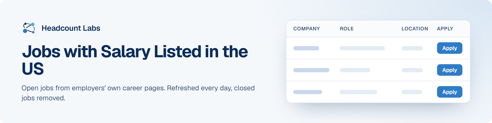

# Jobs with Salary Listed in the US

Open jobs at US employers that publish the pay range, sorted by field.

**227 open jobs** · 227 new since the last update · 275 removed because they closed or left the employer's board · updated November 14, 2026 at 5:06 AM EST

This list is built and refreshed every day by [Headcount Labs](https://headcountlabs.com/?utm_source=github&utm_medium=job-list&utm_campaign=pay-transparency-jobs), which reads jobs straight from employers' own career pages and job boards. Every job here was still listed on its source board when we last read that board, within the past 3 days, and was posted in the past 30 days. Copies of the same job are merged into one row, and jobs that close are removed at the next update.

Want this data in your own app or agent? Use the [Headcount Labs jobs API](https://headcountlabs.com/docs/?utm_source=github&utm_medium=job-list&utm_campaign=pay-transparency-jobs) (free tier), the [MCP server](https://headcountlabs.com/mcp/?utm_source=github&utm_medium=job-list&utm_campaign=pay-transparency-jobs) for Claude, ChatGPT and other AI assistants, or the [public dataset subsets](https://huggingface.co/HeadcountLabs) on Hugging Face (the full dataset is coming soon).

**Full dataset.** A bigger, one-off snapshot dated 2026-10-19 (all matching jobs, not only the open jobs below) is on Hugging Face: [Jobs with posted pay](https://huggingface.co/datasets/HeadcountLabs/pay-transparency-jobs). It loads with `datasets.load_dataset` and is under the Open Database License (ODbL) 1.0.

**Jump to:** [Software engineering (8)](#software-engineering) · [Data, AI and machine learning (6)](#data-ai-and-machine-learning) · [Product and design (2)](#product-and-design) · [Hardware and engineering (12)](#hardware-and-engineering) · [Business, finance and operations (20)](#business-finance-and-operations) · [Healthcare (46)](#healthcare) · [Other roles (133)](#other-roles)

**Columns.** *Apply* opens the original posting on the employer's site. *Details* opens the job on Headcount Labs, with every posting we found for it. *Remote* shows what the employer states; a dash means the posting doesn't say. *Pay* is the range the employer published.

## Software engineering

| Company | Role | Location | Remote | Pay | Posted | Apply | Details |
| --- | --- | --- | --- | --- | --- | :---: | :---: |
| **Integrated Biosciences, Inc.** | Software Engineer, Robotics | Redwood City, CA | On-site | $140k–$230k/yr | Nov 14 |  | <a href="https://headcountlabs.com/catalog/jobs/dbfd259c-60da-43bc-b779-403253f47167?utm_source=github&utm_medium=job-list&utm_campaign=pay-transparency-jobs">via Headcount Labs</a> |
| **Arthrex** | Senior Software Engineer- Backend GoLang (Remote) | 

3 locations
United States Boston, MA Oregon
 | Remote | $90k/yr | Nov 14 |  | <a href="https://headcountlabs.com/catalog/jobs/a17e372f-cb72-4404-9f41-42514076bcd7?utm_source=github&utm_medium=job-list&utm_campaign=pay-transparency-jobs">via Headcount Labs</a> |
| **COGNIZANT TECH SOLUTIONS A** | Senior Healthcare QA Engineer – Payer/ Claims | Norfolk, VA | Remote | $96k–$110k/yr | Nov 13 |  | <a href="https://headcountlabs.com/catalog/jobs/98f565da-5d2a-4345-b1b8-d410c5c5eee3?utm_source=github&utm_medium=job-list&utm_campaign=pay-transparency-jobs">via Headcount Labs</a> |
| **COGNIZANT TECH SOLUTIONS A** | Senior .NET Full Stack Developer (C# / Angular) - Onsite | Lake Forest, CA | On-site | $90k–$118k/yr | Nov 13 |  | <a href="https://headcountlabs.com/catalog/jobs/88ef3119-464b-413b-b6e2-4b99ae0cf187?utm_source=github&utm_medium=job-list&utm_campaign=pay-transparency-jobs">via Headcount Labs</a> |
| **COGNIZANT TECH SOLUTIONS A** | Senior Healthcare Payer Claims QA Engineer | Norfolk, VA | Remote | $96k–$110k/yr | Nov 13 |  | <a href="https://headcountlabs.com/catalog/jobs/1f5389e7-5108-4898-936b-4087301a5054?utm_source=github&utm_medium=job-list&utm_campaign=pay-transparency-jobs">via Headcount Labs</a> |
| **Arm** | SoC Functional Safety and Cybersecurity Manager | Austin, TX | — | $198k–$268k/yr | Nov 13 |  | <a href="https://headcountlabs.com/catalog/jobs/b6aa1316-811a-444a-be56-18fa2cf80c7a?utm_source=github&utm_medium=job-list&utm_campaign=pay-transparency-jobs">via Headcount Labs</a> |
| **8th Light** | Lead Software Engineer (Remote) | United States | Remote | $126k–$158k/yr | Nov 6 |  | <a href="https://headcountlabs.com/catalog/jobs/705b77bd-ee18-4eb8-9ef4-db6d4b81d3d0?utm_source=github&utm_medium=job-list&utm_campaign=pay-transparency-jobs">via Headcount Labs</a> |
| **8th Light** | Principal Software Engineer (Remote) | United States | Remote | $152k–$189k/yr | Nov 6 |  | <a href="https://headcountlabs.com/catalog/jobs/3064bb80-c7e0-4509-a3eb-1a79119d8c4d?utm_source=github&utm_medium=job-list&utm_campaign=pay-transparency-jobs">via Headcount Labs</a> |

## Data, AI and machine learning

| Company | Role | Location | Remote | Pay | Posted | Apply | Details |
| --- | --- | --- | --- | --- | --- | :---: | :---: |
| **Integrated Biosciences, Inc.** | Scientist / Senior Scientist, Medicinal Chemistry | Redwood City, CA | On-site | $120k–$170k/yr | Nov 14 |  | <a href="https://headcountlabs.com/catalog/jobs/250bdc6a-7087-4584-a141-c01255c0da66?utm_source=github&utm_medium=job-list&utm_campaign=pay-transparency-jobs">via Headcount Labs</a> |
| **FirstEnergy** | Supervisor Project Controls Analytics - Project Management Controls - Akron FirstEnergy Headquarters | 

4 locations
Akron, OH Morristown, NJ Reading, PA Greensburg, PA
 | On-site | $116k–$136k/yr | Nov 13 |  | <a href="https://headcountlabs.com/catalog/jobs/daaf68d1-894d-478f-af21-6b84c787a85c?utm_source=github&utm_medium=job-list&utm_campaign=pay-transparency-jobs">via Headcount Labs</a> |
| **Culver Franchising System, LLC** | Senior Data &amp; Pricing Analyst | Prairie Du Sac, WI | — | $80k–$95k/yr | Nov 13 |  | <a href="https://headcountlabs.com/catalog/jobs/0a081a75-1f30-4c76-bf99-4d489f73380a?utm_source=github&utm_medium=job-list&utm_campaign=pay-transparency-jobs">via Headcount Labs</a> |
| **COGNIZANT TECH SOLUTIONS A** | Program Manager - AI-Driven Quality Engineering Transformation (Life Insurance) | Boston (III), MA | Hybrid | $116k–$184k/yr | Nov 13 |  | <a href="https://headcountlabs.com/catalog/jobs/84cc5f41-663c-4393-bdf8-4ffb41fe2c32?utm_source=github&utm_medium=job-list&utm_campaign=pay-transparency-jobs">via Headcount Labs</a> |
| **Arm** | Machine Learning Engineering Intern (MS/PhD) | Austin, TX | — | $50–$60/hr | Nov 13 |  | <a href="https://headcountlabs.com/catalog/jobs/e8fbbdec-286e-4a96-b1f8-4f6d5d10b0c1?utm_source=github&utm_medium=job-list&utm_campaign=pay-transparency-jobs">via Headcount Labs</a> |
| **GAF** | Senior Sales Enablement Data &amp; AI Analyst | Parsippany, NJ | — | $92k–$126k/yr | Nov 12 |  | <a href="https://headcountlabs.com/catalog/jobs/80d80a93-9841-4bea-a7b7-1efcc00fa885?utm_source=github&utm_medium=job-list&utm_campaign=pay-transparency-jobs">via Headcount Labs</a> |

## Product and design

| Company | Role | Location | Remote | Pay | Posted | Apply | Details |
| --- | --- | --- | --- | --- | --- | :---: | :---: |
| **Nomura** | Product Manager- Electronic Trading | New York | — | $190k–$250k/yr | Nov 13 |  | <a href="https://headcountlabs.com/catalog/jobs/6191f5a4-b799-4b9f-8346-debab7de71d9?utm_source=github&utm_medium=job-list&utm_campaign=pay-transparency-jobs">via Headcount Labs</a> |
| **BETA GROUP INC** | Traffic Engineering Designer | Norwood, MA | — | $77k–$87k/yr | Nov 13 |  | <a href="https://headcountlabs.com/catalog/jobs/e13c5db0-31a4-47b6-b493-a6c2cc8c1a4b?utm_source=github&utm_medium=job-list&utm_campaign=pay-transparency-jobs">via Headcount Labs</a> |

## Hardware and engineering

| Company | Role | Location | Remote | Pay | Posted | Apply | Details |
| --- | --- | --- | --- | --- | --- | :---: | :---: |
| **NORTHROP GRUMMAN SYSTEMS CORPORATION** | Electronics/ Principal Electronics Communication Engineer | Palmdale, CA | On-site | $92k–$138k/yr | Nov 14 |  | <a href="https://headcountlabs.com/catalog/jobs/20ec1807-8866-4b37-a882-6b82be8dbac7?utm_source=github&utm_medium=job-list&utm_campaign=pay-transparency-jobs">via Headcount Labs</a> |
| **Royal American Construction** | PROJECT ENGINEER QC SPECIALIST | Miami, FL | — | $65k–$75k/yr | Nov 13 |  | <a href="https://headcountlabs.com/catalog/jobs/098747c4-f747-428b-a05c-377a0e55e99c?utm_source=github&utm_medium=job-list&utm_campaign=pay-transparency-jobs">via Headcount Labs</a> |
| **NORTHROP GRUMMAN SYSTEMS CORPORATION** | 2027 Materials &amp; Process Engineering Intern - Northridge CA | Los Angeles, CA | On-site | $26.75–$39/hr | Nov 13 |  | <a href="https://headcountlabs.com/catalog/jobs/eef23c18-2e37-40ac-9d2d-b4c39bfac9ef?utm_source=github&utm_medium=job-list&utm_campaign=pay-transparency-jobs">via Headcount Labs</a> |
| **NORTHROP GRUMMAN SYSTEMS CORPORATION** | Manufacturing Technician Level 2/3 | Iuka, MS | On-site | $42k–$70k/yr | Nov 13 |  | <a href="https://headcountlabs.com/catalog/jobs/ec84a025-fa1b-4247-b360-abc19759a7a2?utm_source=github&utm_medium=job-list&utm_campaign=pay-transparency-jobs">via Headcount Labs</a> |
| **NORTHROP GRUMMAN SYSTEMS CORPORATION** | Staff Engineer Aeronautical - Liaison/MRB (4/10 1st Shift) | Edwards AFB, CA | On-site | $177k–$266k/yr | Nov 13 |  | <a href="https://headcountlabs.com/catalog/jobs/ec6efea5-855e-412b-9000-ca4cbbd7d3e1?utm_source=github&utm_medium=job-list&utm_campaign=pay-transparency-jobs">via Headcount Labs</a> |
| **GAF** | Manufacturing Production Operator | Baltimore, MD | — | $29.47/hr | Nov 13 |  | <a href="https://headcountlabs.com/catalog/jobs/bd7fec54-78ee-44ca-ac16-4c3beecfb074?utm_source=github&utm_medium=job-list&utm_campaign=pay-transparency-jobs">via Headcount Labs</a> |
| **COGNIZANT TECH SOLUTIONS A** | Senior SDET / QA Automation Engineer (Playwright, Selenium, Java &amp; Cucumber) | 

2 locations
Phoenix, AZ AZ-N Norterra Pkwy, AZ
 | Remote | $62k–$99k/yr | Nov 13 |  | <a href="https://headcountlabs.com/catalog/jobs/9ad429bf-2b67-4827-ad39-90a83610a47c?utm_source=github&utm_medium=job-list&utm_campaign=pay-transparency-jobs">via Headcount Labs</a> |
| **BETA GROUP INC** | Senior Stormwater Project Engineer | Norwood, MA | — | $107k–$139k/yr | Nov 13 |  | <a href="https://headcountlabs.com/catalog/jobs/f6f613a0-fd83-4ac9-aafc-4700b4e70e07?utm_source=github&utm_medium=job-list&utm_campaign=pay-transparency-jobs">via Headcount Labs</a> |
| **BETA GROUP INC** | Senior Transportation Project Engineer | 

2 locations
Worcester, MA Lincoln, RI
 | — | $102k–$139k/yr | Nov 13 |  | <a href="https://headcountlabs.com/catalog/jobs/ef1911a4-e784-4770-9662-636500dd1d51?utm_source=github&utm_medium=job-list&utm_campaign=pay-transparency-jobs">via Headcount Labs</a> |
| **BETA GROUP INC** | Structural Project Engineer | 

3 locations
Lincoln, RI Norwood, MA Manchester, NH
 | — | $89k–$116k/yr | Nov 13 |  | <a href="https://headcountlabs.com/catalog/jobs/cfb4db92-ba0d-4db4-9c0b-7777275bc4c3?utm_source=github&utm_medium=job-list&utm_campaign=pay-transparency-jobs">via Headcount Labs</a> |
| **BETA GROUP INC** | Senior Traffic Engineer | 

4 locations
Lincoln, RI Worcester, MA Hartford, CT Norwood, MA
 | — | $106k–$160k/yr | Nov 13 |  | <a href="https://headcountlabs.com/catalog/jobs/bfbf4f47-1e1f-4e10-bef0-2779734d1f3a?utm_source=github&utm_medium=job-list&utm_campaign=pay-transparency-jobs">via Headcount Labs</a> |
| **Adapture Renewables** | Sr. BESS Engineer | Oakland, CA | — | $117k–$145k/yr | Oct 16 |  | <a href="https://headcountlabs.com/catalog/jobs/7cccdf97-1c4f-492d-916d-ac683b846a88?utm_source=github&utm_medium=job-list&utm_campaign=pay-transparency-jobs">via Headcount Labs</a> |

## Business, finance and operations

| Company | Role | Location | Remote | Pay | Posted | Apply | Details |
| --- | --- | --- | --- | --- | --- | :---: | :---: |
| **True Fitness Technology Inc** | Direct Sales Representative | 

3 locations
Seattle, WA Denver, CO Phoenix, AZ
 | Remote | $65k–$100k/yr | Nov 13 |  | <a href="https://headcountlabs.com/catalog/jobs/abfc1093-8080-4007-bfa6-b81d6bbae471?utm_source=github&utm_medium=job-list&utm_campaign=pay-transparency-jobs">via Headcount Labs</a> |
| **TemPositions** | Retail Sales Associate - OrderID: 5368 | New York, NY | — | $19–$21/hr | Nov 13 | <a href="https://apply-jobs.apploi.com/job/2015646?utm_campaign=integration&amp;utm_medium=job-board-search&amp;utm_source=company_profile_page&amp;language=en&amp;ajs_event=LOAD_JOB_PAGE&amp;ajs_aid=3f617530-4530-11e9-a2ca-7e775511d9e3&amp;ajs_prop_search_fetch_id=25095e1f906f4ff1947b6d228a169796&amp;ajs_prop_keyword=&amp;ajs_prop_page=1&amp;ajs_prop_city_center=Unselected&amp;ajs_prop_language=en&amp;ajs_prop_search_order=1&amp;ajs_prop_job_id=2015646&amp;ajs_prop_doc_type=job&amp;ajs_prop_job_location_lat=40.7686973&amp;ajs_prop_job_location_lon=-73.9918181&amp;ajs_prop_boosted=0&amp;ajs_prop_utm_source=company_profile_page&amp;ajs_prop_utm_medium=job-board-search&amp;ajs_prop_utm_campaign=integration"></a> | <a href="https://headcountlabs.com/catalog/jobs/bcf95c7b-1b7a-47b2-9a09-653f7fcaaf6e?utm_source=github&utm_medium=job-list&utm_campaign=pay-transparency-jobs">via Headcount Labs</a> |
| **Super-Sod** | Outside Sales Representative - South Atlanta | McDonough, GA | — | $48k–$120k/yr | Nov 13 |  | <a href="https://headcountlabs.com/catalog/jobs/ecdd826d-0dde-4ec4-9037-7a16880d5e80?utm_source=github&utm_medium=job-list&utm_campaign=pay-transparency-jobs">via Headcount Labs</a> |
| **Super-Sod** | Outside Sales Representative - NE Dallas,TX | Dallas, NE | — | $48k–$120k/yr | Nov 13 |  | <a href="https://headcountlabs.com/catalog/jobs/bb3c5833-d464-4850-9d35-6ee257266792?utm_source=github&utm_medium=job-list&utm_campaign=pay-transparency-jobs">via Headcount Labs</a> |
| **Protagonist** | Strategic Communications Analyst | Washington, DC | — | $68k–$85k/yr | Nov 13 |  | <a href="https://headcountlabs.com/catalog/jobs/2fe796c1-1ccb-4cdb-9a19-a88db3264c00?utm_source=github&utm_medium=job-list&utm_campaign=pay-transparency-jobs">via Headcount Labs</a> |
| **Ourisman Honda of Bethesda** | Internet Sales Manager | Bethesda, MD | — | $80k–$100k/yr | Nov 13 |  | <a href="https://headcountlabs.com/catalog/jobs/68962ca3-5a19-46bb-83c4-9aa407b55e56?utm_source=github&utm_medium=job-list&utm_campaign=pay-transparency-jobs">via Headcount Labs</a> |
| **NORTHROP GRUMMAN SYSTEMS CORPORATION** | Supply Chain Procurement Specialist Level 2 or 3 | 

3 locations
El Segundo, CA Melbourne, FL Palmdale, CA
 | Hybrid | $69k–$111k/yr | Nov 13 |  | <a href="https://headcountlabs.com/catalog/jobs/f1b1b0e8-c886-4320-b5f2-391149af6feb?utm_source=github&utm_medium=job-list&utm_campaign=pay-transparency-jobs">via Headcount Labs</a> |
| **N-Power Medicine** | Director of Product Marketing | Redwood City, CA | Hybrid | $176k–$237k/yr | Nov 13 |  | <a href="https://headcountlabs.com/catalog/jobs/4ec5d3f9-7cf1-464d-bb02-01cee7aa71b4?utm_source=github&utm_medium=job-list&utm_campaign=pay-transparency-jobs">via Headcount Labs</a> |
| **Highland Health and Rehabilitation** | Registered Nurse (RN)– Part-Time Night Shift (10pm–6:30am) – $48–$55/hr + Night Differential | Bellingham, WA | — | $48–$55/hr | Nov 13 |  | <a href="https://headcountlabs.com/catalog/jobs/9aa8f079-932e-4fee-b4fe-b621f4dfab85?utm_source=github&utm_medium=job-list&utm_campaign=pay-transparency-jobs">via Headcount Labs</a> |
| **Highland Health and Rehabilitation** | Registered Nurse (RN)– Full-Time Night Shift (10pm–6:30am) – $48–$55/hr + Night Differential | Bellingham, WA | — | $48–$55/hr | Nov 13 |  | <a href="https://headcountlabs.com/catalog/jobs/05e5f41c-6802-4221-af78-c70d4814b0d6?utm_source=github&utm_medium=job-list&utm_campaign=pay-transparency-jobs">via Headcount Labs</a> |
| **Helmsley** | Internal Communications Associate | New York, NY | — | $92k–$100k/yr | Nov 13 |  | <a href="https://headcountlabs.com/catalog/jobs/9a433711-116b-42a1-bd82-a66426d8fbf8?utm_source=github&utm_medium=job-list&utm_campaign=pay-transparency-jobs">via Headcount Labs</a> |
| **Hantzmon Wiebel LLP** | Seasonal Tax Scanner | Charlottesville, VA | On-site | $20/hr | Nov 13 |  | <a href="https://headcountlabs.com/catalog/jobs/02dacc3e-acb5-47f4-a0e5-68f4712389d8?utm_source=github&utm_medium=job-list&utm_campaign=pay-transparency-jobs">via Headcount Labs</a> |
| **Hantzmon Wiebel LLP** | Tax Return Processing Center Team Member (TRPC) | Charlottesville, VA | On-site | $20–$24/hr | Nov 13 |  | <a href="https://headcountlabs.com/catalog/jobs/8eca60d3-62e0-4e6e-aca0-36b698a2aba2?utm_source=github&utm_medium=job-list&utm_campaign=pay-transparency-jobs">via Headcount Labs</a> |
| **GSR** | Institutional Sales - VP / Director | New York, NY | — | $200k–$300k/yr | Nov 13 |  | <a href="https://headcountlabs.com/catalog/jobs/a26fd314-8462-446f-b2ed-0f7fa6ef7296?utm_source=github&utm_medium=job-list&utm_campaign=pay-transparency-jobs">via Headcount Labs</a> |
| **GAF** | Senior Financial Analyst | Parsippany, NJ | — | $92k–$126k/yr | Nov 13 |  | <a href="https://headcountlabs.com/catalog/jobs/2eb051e0-c095-4db9-b552-96dacacfaa34?utm_source=github&utm_medium=job-list&utm_campaign=pay-transparency-jobs">via Headcount Labs</a> |
| **FinQuery** | People Business Partner | Atlanta, GA | Hybrid | $85k–$100k/yr | Nov 13 |  | <a href="https://headcountlabs.com/catalog/jobs/722a82f3-7b18-4089-9661-d0f1ba2e3d1a?utm_source=github&utm_medium=job-list&utm_campaign=pay-transparency-jobs">via Headcount Labs</a> |
| **Conduent State &amp; Local Solutions, Inc** | Fraud Support Analyst | United States | Remote | $58k–$75k/yr | Nov 13 |  | <a href="https://headcountlabs.com/catalog/jobs/dfe75d27-c4e9-450d-af25-dfaefc1eaa9c?utm_source=github&utm_medium=job-list&utm_campaign=pay-transparency-jobs">via Headcount Labs</a> |
| **COGNIZANT TECH SOLUTIONS A** | Consulting Principal - o9 Architecture | New Jersey, NJ | Remote | $122k–$191k/yr | Nov 13 |  | <a href="https://headcountlabs.com/catalog/jobs/21f94fd7-0a8c-4507-a9ee-75594d620a61?utm_source=github&utm_medium=job-list&utm_campaign=pay-transparency-jobs">via Headcount Labs</a> |
| **Nomura** | Hedge Fund Credit Risk Analyst | New York | — | $85k–$105k/yr | Oct 30 |  | <a href="https://headcountlabs.com/catalog/jobs/f9a4ff3d-eccf-4c1a-949f-0256903f13f8?utm_source=github&utm_medium=job-list&utm_campaign=pay-transparency-jobs">via Headcount Labs</a> |
| **Mississippi Title Loans, Inc** | Sales Representative | 

4 locations
Tupelo, MS Columbus, MS Jackson, MS Laurel, MS
 | — | $13.25–$14.15/hr | Oct 30 |  | <a href="https://headcountlabs.com/catalog/jobs/65e26c6a-8f9b-4a10-a390-88f10607d32d?utm_source=github&utm_medium=job-list&utm_campaign=pay-transparency-jobs">via Headcount Labs</a> |

## Healthcare

| Company | Role | Location | Remote | Pay | Posted | Apply | Details |
| --- | --- | --- | --- | --- | --- | :---: | :---: |
| **The Avalon of Commerce Township** | Certified Nursing Assistant (CNA) - Memory Care (Part-Time) | San Diego, CA | On-site | $21–$23/hr | Nov 14 |  | <a href="https://headcountlabs.com/catalog/jobs/db7c9c14-e39d-4bbc-83ed-28cd40a0b89d?utm_source=github&utm_medium=job-list&utm_campaign=pay-transparency-jobs">via Headcount Labs</a> |
| **Unity Care NW** | Nurse Practitioner or Physician Assistant Inboxologist | Bellingham, WA | — | $134k–$167k/yr | Nov 13 |  | <a href="https://headcountlabs.com/catalog/jobs/ac8c5cbd-3c8b-4a65-8359-20ccd79597ee?utm_source=github&utm_medium=job-list&utm_campaign=pay-transparency-jobs">via Headcount Labs</a> |
| **Revenue Group** | Outpatient Medicaid Eligibility Representative | Cleveland, OH | Remote | $14–$14.50/hr | Nov 13 |  | <a href="https://headcountlabs.com/catalog/jobs/fcb5c3e0-00bb-43ba-bae0-5f83b63de114?utm_source=github&utm_medium=job-list&utm_campaign=pay-transparency-jobs">via Headcount Labs</a> |
| **Highland Health and Rehabilitation** | Certified Occupational Therapy Assistant - Part-Time | Bellingham, WA | — | $35–$38/hr | Nov 13 |  | <a href="https://headcountlabs.com/catalog/jobs/f6b7608f-1080-4c05-a134-eab11f5bfa6a?utm_source=github&utm_medium=job-list&utm_campaign=pay-transparency-jobs">via Headcount Labs</a> |
| **Highland Health and Rehabilitation** | Occupational Therapist - Part-time | Bellingham, WA | — | $53–$58/hr | Nov 13 |  | <a href="https://headcountlabs.com/catalog/jobs/2ba38a01-1139-44fc-966a-ba8bd69ed639?utm_source=github&utm_medium=job-list&utm_campaign=pay-transparency-jobs">via Headcount Labs</a> |
| **Earlens** | Patient Care Coordinator | Orchard Park, NY | — | $22–$28/hr | Nov 13 |  | <a href="https://headcountlabs.com/catalog/jobs/9eab6c8e-2947-48b7-be94-93a3fd9552b2?utm_source=github&utm_medium=job-list&utm_campaign=pay-transparency-jobs">via Headcount Labs</a> |
| **Child &amp; Family Guidance Center** | Medical Receptionist | Plano, TX | On-site | $17/hr | Nov 13 |  | <a href="https://headcountlabs.com/catalog/jobs/8ed7d8d9-a117-4633-95ef-334328388a17?utm_source=github&utm_medium=job-list&utm_campaign=pay-transparency-jobs">via Headcount Labs</a> |
| **AGING WELL HEALTH CARE LLC** | Physical Therapist Assistant (PTA) - Assisted Living Facility | Saint Louis, MO | — | $42.15/hr | Nov 13 |  | <a href="https://headcountlabs.com/catalog/jobs/de01558e-acd1-4da9-9daf-8f15b6f299c3?utm_source=github&utm_medium=job-list&utm_campaign=pay-transparency-jobs">via Headcount Labs</a> |
| **AGING WELL HEALTH CARE LLC** | Registered Nurse ( RN ), Home Health | O'Fallon, MO | — | $75k–$90k/yr | Nov 13 |  | <a href="https://headcountlabs.com/catalog/jobs/5a7b637b-4fde-455e-bf24-de9b1df3c187?utm_source=github&utm_medium=job-list&utm_campaign=pay-transparency-jobs">via Headcount Labs</a> |
| **Evergreen Post Acute Rehab** | Staff Development Registered Nurse (RN) | Smyrna, DE | — | $90k–$95k/yr | Nov 11 | <a href="https://apply-jobs.apploi.com/job/1931764?utm_campaign=integration&amp;utm_medium=job-board-search&amp;utm_source=company_profile_page&amp;language=en&amp;ajs_event=LOAD_JOB_PAGE&amp;ajs_aid=3f617530-4530-11e9-a2ca-7e775511d9e3&amp;ajs_prop_search_fetch_id=e901deaa0c334e4ebdb39ccae421a1c2&amp;ajs_prop_keyword=&amp;ajs_prop_page=1&amp;ajs_prop_city_center=Unselected&amp;ajs_prop_language=en&amp;ajs_prop_search_order=1&amp;ajs_prop_job_id=1931764&amp;ajs_prop_doc_type=job&amp;ajs_prop_job_location_lat=39.2618748&amp;ajs_prop_job_location_lon=-75.5884351&amp;ajs_prop_boosted=0&amp;ajs_prop_utm_source=company_profile_page&amp;ajs_prop_utm_medium=job-board-search&amp;ajs_prop_utm_campaign=integration"></a> | <a href="https://headcountlabs.com/catalog/jobs/7263c884-b59c-48a3-b5b6-482fc465eec7?utm_source=github&utm_medium=job-list&utm_campaign=pay-transparency-jobs">via Headcount Labs</a> |
| **Vitalia Active Adult Community at Montrose** | Wellness Nurse Manager 6am-6pm $32-39.50 (Part Time) | Copley, OH | — | $32–$39.50/hr | Nov 10 |  | <a href="https://headcountlabs.com/catalog/jobs/7654f92a-a85a-4a46-bc05-a3db029e9d22?utm_source=github&utm_medium=job-list&utm_campaign=pay-transparency-jobs">via Headcount Labs</a> |
| **Right at Home Gainesville Northeast Georgia** | Greater Athens Area Registered Nurse (RN) – PRN | Watkinsville, GA | — | $60–$80/hr | Nov 9 | <a href="https://apply-jobs.apploi.com/job/1912425?utm_campaign=integration&amp;utm_medium=job-board-search&amp;utm_source=company_profile_page&amp;language=en&amp;ajs_event=LOAD_JOB_PAGE&amp;ajs_aid=3f617530-4530-11e9-a2ca-7e775511d9e3&amp;ajs_prop_search_fetch_id=13a2e48f0be1486583381d20dc504ceb&amp;ajs_prop_keyword=&amp;ajs_prop_page=1&amp;ajs_prop_city_center=Unselected&amp;ajs_prop_language=en&amp;ajs_prop_search_order=1&amp;ajs_prop_job_id=1912425&amp;ajs_prop_doc_type=job&amp;ajs_prop_job_location_lat=33.9188986&amp;ajs_prop_job_location_lon=-83.4652742&amp;ajs_prop_boosted=0&amp;ajs_prop_utm_source=company_profile_page&amp;ajs_prop_utm_medium=job-board-search&amp;ajs_prop_utm_campaign=integration"></a> | <a href="https://headcountlabs.com/catalog/jobs/24eff162-533b-4f12-b41c-5985b2cd3329?utm_source=github&utm_medium=job-list&utm_campaign=pay-transparency-jobs">via Headcount Labs</a> |
| **Evergreen Post Acute Rehab** | Certified Nurse Aide (CNA) | Smyrna, DE | — | $19–$25.30/hr | Nov 9 | <a href="https://apply-jobs.apploi.com/job/1974676?utm_campaign=integration&amp;utm_medium=job-board-search&amp;utm_source=company_profile_page&amp;language=en&amp;ajs_event=LOAD_JOB_PAGE&amp;ajs_aid=3f617530-4530-11e9-a2ca-7e775511d9e3&amp;ajs_prop_search_fetch_id=e901deaa0c334e4ebdb39ccae421a1c2&amp;ajs_prop_keyword=&amp;ajs_prop_page=1&amp;ajs_prop_city_center=Unselected&amp;ajs_prop_language=en&amp;ajs_prop_search_order=2&amp;ajs_prop_job_id=1974676&amp;ajs_prop_doc_type=job&amp;ajs_prop_job_location_lat=39.2618748&amp;ajs_prop_job_location_lon=-75.5884351&amp;ajs_prop_boosted=0&amp;ajs_prop_utm_source=company_profile_page&amp;ajs_prop_utm_medium=job-board-search&amp;ajs_prop_utm_campaign=integration"></a> | <a href="https://headcountlabs.com/catalog/jobs/6f2f83de-557c-45f1-9607-012ffdb8897d?utm_source=github&utm_medium=job-list&utm_campaign=pay-transparency-jobs">via Headcount Labs</a> |
| **Alden Park Strathmoor** | Behavioral Health Counselor | Rockford, IL | — | $22/hr | Nov 9 | <a href="https://apply-jobs.apploi.com/job/797686?utm_campaign=integration&amp;utm_medium=job-board-search&amp;utm_source=company_profile_page&amp;language=en&amp;ajs_event=LOAD_JOB_PAGE&amp;ajs_aid=3f617530-4530-11e9-a2ca-7e775511d9e3&amp;ajs_prop_search_fetch_id=2d89efa759eb40fca99af6a392f8f64b&amp;ajs_prop_keyword=&amp;ajs_prop_page=1&amp;ajs_prop_city_center=Unselected&amp;ajs_prop_language=en&amp;ajs_prop_search_order=1&amp;ajs_prop_job_id=797686&amp;ajs_prop_doc_type=job&amp;ajs_prop_job_location_lat=42.2689998&amp;ajs_prop_job_location_lon=-89.0051604&amp;ajs_prop_boosted=0&amp;ajs_prop_utm_source=company_profile_page&amp;ajs_prop_utm_medium=job-board-search&amp;ajs_prop_utm_campaign=integration"></a> | <a href="https://headcountlabs.com/catalog/jobs/83ea797a-1ab4-4119-bde0-a3b9aebe5771?utm_source=github&utm_medium=job-list&utm_campaign=pay-transparency-jobs">via Headcount Labs</a> |
| **Alden Park Strathmoor** | Staff Nurse (RN) PM SHIFT | Machesney Park, IL | — | $45/hr | Nov 9 | <a href="https://apply-jobs.apploi.com/job/1103848?utm_campaign=integration&amp;utm_medium=job-board-search&amp;utm_source=company_profile_page&amp;language=en&amp;ajs_event=LOAD_JOB_PAGE&amp;ajs_aid=3f617530-4530-11e9-a2ca-7e775511d9e3&amp;ajs_prop_search_fetch_id=2d89efa759eb40fca99af6a392f8f64b&amp;ajs_prop_keyword=&amp;ajs_prop_page=1&amp;ajs_prop_city_center=Unselected&amp;ajs_prop_language=en&amp;ajs_prop_search_order=3&amp;ajs_prop_job_id=1103848&amp;ajs_prop_doc_type=job&amp;ajs_prop_job_location_lat=42.3472406&amp;ajs_prop_job_location_lon=-89.0389956&amp;ajs_prop_boosted=0&amp;ajs_prop_utm_source=company_profile_page&amp;ajs_prop_utm_medium=job-board-search&amp;ajs_prop_utm_campaign=integration"></a> | <a href="https://headcountlabs.com/catalog/jobs/8040e641-2b48-400d-937d-6f9f60acae26?utm_source=github&utm_medium=job-list&utm_campaign=pay-transparency-jobs">via Headcount Labs</a> |
| **Alden Park Strathmoor** | Behavioral Health Director | Rockford, IL | — | $65k–$75k/yr | Nov 9 | <a href="https://apply-jobs.apploi.com/job/797693?utm_campaign=integration&amp;utm_medium=job-board-search&amp;utm_source=company_profile_page&amp;language=en&amp;ajs_event=LOAD_JOB_PAGE&amp;ajs_aid=3f617530-4530-11e9-a2ca-7e775511d9e3&amp;ajs_prop_search_fetch_id=2d89efa759eb40fca99af6a392f8f64b&amp;ajs_prop_keyword=&amp;ajs_prop_page=1&amp;ajs_prop_city_center=Unselected&amp;ajs_prop_language=en&amp;ajs_prop_search_order=2&amp;ajs_prop_job_id=797693&amp;ajs_prop_doc_type=job&amp;ajs_prop_job_location_lat=42.269057&amp;ajs_prop_job_location_lon=-89.0051753&amp;ajs_prop_boosted=0&amp;ajs_prop_utm_source=company_profile_page&amp;ajs_prop_utm_medium=job-board-search&amp;ajs_prop_utm_campaign=integration"></a> | <a href="https://headcountlabs.com/catalog/jobs/4cc903ff-c364-4569-90ce-3e2d9c0f8f88?utm_source=github&utm_medium=job-list&utm_campaign=pay-transparency-jobs">via Headcount Labs</a> |
| **Evergreen Post Acute Rehab** | Registered Nurse (RN) | Smyrna, DE | — | $35–$44/hr | Nov 4 | <a href="https://apply-jobs.apploi.com/job/1728372?utm_campaign=integration&amp;utm_medium=job-board-search&amp;utm_source=company_profile_page&amp;language=en&amp;ajs_event=LOAD_JOB_PAGE&amp;ajs_aid=3f617530-4530-11e9-a2ca-7e775511d9e3&amp;ajs_prop_search_fetch_id=e901deaa0c334e4ebdb39ccae421a1c2&amp;ajs_prop_keyword=&amp;ajs_prop_page=1&amp;ajs_prop_city_center=Unselected&amp;ajs_prop_language=en&amp;ajs_prop_search_order=4&amp;ajs_prop_job_id=1728372&amp;ajs_prop_doc_type=job&amp;ajs_prop_job_location_lat=39.2619547&amp;ajs_prop_job_location_lon=-75.5887535&amp;ajs_prop_boosted=0&amp;ajs_prop_utm_source=company_profile_page&amp;ajs_prop_utm_medium=job-board-search&amp;ajs_prop_utm_campaign=integration"></a> | <a href="https://headcountlabs.com/catalog/jobs/6d274282-2162-4e80-918b-c05bb6c9d8ce?utm_source=github&utm_medium=job-list&utm_campaign=pay-transparency-jobs">via Headcount Labs</a> |
| **Evergreen Post Acute Rehab** | Licensed Practical Nurse (LPN) | Smyrna, DE | — | $30–$39/hr | Nov 4 | <a href="https://apply-jobs.apploi.com/job/1728366?utm_campaign=integration&amp;utm_medium=job-board-search&amp;utm_source=company_profile_page&amp;language=en&amp;ajs_event=LOAD_JOB_PAGE&amp;ajs_aid=3f617530-4530-11e9-a2ca-7e775511d9e3&amp;ajs_prop_search_fetch_id=e901deaa0c334e4ebdb39ccae421a1c2&amp;ajs_prop_keyword=&amp;ajs_prop_page=1&amp;ajs_prop_city_center=Unselected&amp;ajs_prop_language=en&amp;ajs_prop_search_order=5&amp;ajs_prop_job_id=1728366&amp;ajs_prop_doc_type=job&amp;ajs_prop_job_location_lat=39.2619721&amp;ajs_prop_job_location_lon=-75.5886704&amp;ajs_prop_boosted=0&amp;ajs_prop_utm_source=company_profile_page&amp;ajs_prop_utm_medium=job-board-search&amp;ajs_prop_utm_campaign=integration"></a> | <a href="https://headcountlabs.com/catalog/jobs/5c28f7a3-5a33-4b47-8b07-9f31d45c7602?utm_source=github&utm_medium=job-list&utm_campaign=pay-transparency-jobs">via Headcount Labs</a> |
| **Cottonwood Rehabilitation and Healthcare Center LLC** | Charge Nurse RN | Durango, CO | — | $38–$45/hr | Nov 3 | <a href="https://apply-jobs.apploi.com/job/1889513?utm_campaign=integration&amp;utm_medium=job-board-search&amp;utm_source=company_profile_page&amp;language=en&amp;ajs_event=LOAD_JOB_PAGE&amp;ajs_aid=3f617530-4530-11e9-a2ca-7e775511d9e3&amp;ajs_prop_search_fetch_id=04de28748c8a4d49a274e942bf98bd25&amp;ajs_prop_keyword=&amp;ajs_prop_page=1&amp;ajs_prop_city_center=Unselected&amp;ajs_prop_language=en&amp;ajs_prop_search_order=3&amp;ajs_prop_job_id=1889513&amp;ajs_prop_doc_type=job&amp;ajs_prop_job_location_lat=37.2391102&amp;ajs_prop_job_location_lon=-107.817895&amp;ajs_prop_boosted=0&amp;ajs_prop_utm_source=company_profile_page&amp;ajs_prop_utm_medium=job-board-search&amp;ajs_prop_utm_campaign=integration"></a> | <a href="https://headcountlabs.com/catalog/jobs/65cd5b16-afeb-498b-93f6-b5c40bb3d82e?utm_source=github&utm_medium=job-list&utm_campaign=pay-transparency-jobs">via Headcount Labs</a> |
| **Dana-Farber Cancer Institute** | Clinical Assistant Yawkey 9 | BOSTON, MA | — | $50k–$63k/yr | Nov 2 |  | <a href="https://headcountlabs.com/catalog/jobs/71714864-daee-49c7-9083-eebb3c52eef3?utm_source=github&utm_medium=job-list&utm_campaign=pay-transparency-jobs">via Headcount Labs</a> |
| **Dana-Farber Cancer Institute** | Clinical Scheduling Specialist I | BROOKLINE, MA | — | $46k–$54k/yr | Nov 2 |  | <a href="https://headcountlabs.com/catalog/jobs/2cf27dfb-91c0-48b9-a8cf-9b2e89d9be37?utm_source=github&utm_medium=job-list&utm_campaign=pay-transparency-jobs">via Headcount Labs</a> |
| **Cottonwood Rehabilitation and Healthcare Center LLC** | Registered Nurse RN | Durango, CO | — | $38–$45/hr | Nov 2 | <a href="https://apply-jobs.apploi.com/job/952534?utm_campaign=integration&amp;utm_medium=job-board-search&amp;utm_source=company_profile_page&amp;language=en&amp;ajs_event=LOAD_JOB_PAGE&amp;ajs_aid=3f617530-4530-11e9-a2ca-7e775511d9e3&amp;ajs_prop_search_fetch_id=04de28748c8a4d49a274e942bf98bd25&amp;ajs_prop_keyword=&amp;ajs_prop_page=1&amp;ajs_prop_city_center=Unselected&amp;ajs_prop_language=en&amp;ajs_prop_search_order=5&amp;ajs_prop_job_id=952534&amp;ajs_prop_doc_type=job&amp;ajs_prop_job_location_lat=37.2387399&amp;ajs_prop_job_location_lon=-107.8179872&amp;ajs_prop_boosted=0&amp;ajs_prop_utm_source=company_profile_page&amp;ajs_prop_utm_medium=job-board-search&amp;ajs_prop_utm_campaign=integration"></a> | <a href="https://headcountlabs.com/catalog/jobs/cf45ca9d-64e1-48e3-9dca-767682f9d233?utm_source=github&utm_medium=job-list&utm_campaign=pay-transparency-jobs">via Headcount Labs</a> |
| **Cottonwood Rehabilitation and Healthcare Center LLC** | Licensed Practical Nurse LPN | Durango, CO | — | $32–$38/hr | Nov 2 | <a href="https://apply-jobs.apploi.com/job/1357479?utm_campaign=integration&amp;utm_medium=job-board-search&amp;utm_source=company_profile_page&amp;language=en&amp;ajs_event=LOAD_JOB_PAGE&amp;ajs_aid=3f617530-4530-11e9-a2ca-7e775511d9e3&amp;ajs_prop_search_fetch_id=04de28748c8a4d49a274e942bf98bd25&amp;ajs_prop_keyword=&amp;ajs_prop_page=1&amp;ajs_prop_city_center=Unselected&amp;ajs_prop_language=en&amp;ajs_prop_search_order=4&amp;ajs_prop_job_id=1357479&amp;ajs_prop_doc_type=job&amp;ajs_prop_job_location_lat=37.2391102&amp;ajs_prop_job_location_lon=-107.817895&amp;ajs_prop_boosted=0&amp;ajs_prop_utm_source=company_profile_page&amp;ajs_prop_utm_medium=job-board-search&amp;ajs_prop_utm_campaign=integration"></a> | <a href="https://headcountlabs.com/catalog/jobs/0634478f-7cd1-4663-b531-31440382c754?utm_source=github&utm_medium=job-list&utm_campaign=pay-transparency-jobs">via Headcount Labs</a> |
| **Dana-Farber Cancer Institute** | Oncology Infusion Pharmacist | BOSTON, MA | — | $124k–$160k/yr | Oct 30 |  | <a href="https://headcountlabs.com/catalog/jobs/81294561-9132-4470-8765-db38f950e5c0?utm_source=github&utm_medium=job-list&utm_campaign=pay-transparency-jobs">via Headcount Labs</a> |
| **Dana-Farber Cancer Institute** | Respiratory Therapist (Per Diem) | BOSTON, MA | — | $100k–$110k/yr | Oct 29 |  | <a href="https://headcountlabs.com/catalog/jobs/376d1af7-a0d3-4289-a0dc-ea988ace71b7?utm_source=github&utm_medium=job-list&utm_campaign=pay-transparency-jobs">via Headcount Labs</a> |
| **Dana-Farber Cancer Institute** | Nurse Practitioner/ Physician Assistant - CCTI Center for Cancer Therapeutic Innovation (20 hrs/wk) | BOSTON, MA | On-site | $126k–$283k/yr | Oct 29 |  | <a href="https://headcountlabs.com/catalog/jobs/a197c373-1aa4-4522-af93-8c59158c1dec?utm_source=github&utm_medium=job-list&utm_campaign=pay-transparency-jobs">via Headcount Labs</a> |
| **Dana-Farber Cancer Institute** | Patient Record Specialist | BROOKLINE, MA | — | $42k–$47k/yr | Oct 29 |  | <a href="https://headcountlabs.com/catalog/jobs/27c561e9-83d8-41b3-b4eb-aae199c77fcc?utm_source=github&utm_medium=job-list&utm_campaign=pay-transparency-jobs">via Headcount Labs</a> |
| **Dana-Farber Cancer Institute** | Clinical Assistant I Per Diem | CHESTNUT HILL, MA | — | $48k–$58k/yr | Oct 29 |  | <a href="https://headcountlabs.com/catalog/jobs/20782c6d-9c15-4977-9d7d-3c0e39511a32?utm_source=github&utm_medium=job-list&utm_campaign=pay-transparency-jobs">via Headcount Labs</a> |
| **Dana-Farber Cancer Institute** | Research Pharmacy Technician | CHESTNUT HILL, MA | — | $53k–$64k/yr | Oct 29 |  | <a href="https://headcountlabs.com/catalog/jobs/1b311288-4feb-4e98-a32e-a56a7ba6d559?utm_source=github&utm_medium=job-list&utm_campaign=pay-transparency-jobs">via Headcount Labs</a> |
| **Behavioral Health** | Psychiatric Mental Health Nurse Practitioner | Portland, OR | On-site | $134k–$174k/yr | Oct 27 |  | <a href="https://headcountlabs.com/catalog/jobs/31e79e63-c627-41ac-bd7f-fd9212642d7d?utm_source=github&utm_medium=job-list&utm_campaign=pay-transparency-jobs">via Headcount Labs</a> |
| **William Penn Nursing and Rehab** | Licensed Practical Nurse (LPN) | Lewistown, PA | — | $25–$31.20/hr | Oct 25 | <a href="https://apply-jobs.apploi.com/job/1427859?utm_campaign=integration&amp;utm_medium=job-board-search&amp;utm_source=company_profile_page&amp;language=en&amp;ajs_event=LOAD_JOB_PAGE&amp;ajs_aid=3f617530-4530-11e9-a2ca-7e775511d9e3&amp;ajs_prop_search_fetch_id=e00f6768ee2742ee996ff2079ac8b515&amp;ajs_prop_keyword=&amp;ajs_prop_page=1&amp;ajs_prop_city_center=Unselected&amp;ajs_prop_language=en&amp;ajs_prop_search_order=4&amp;ajs_prop_job_id=1427859&amp;ajs_prop_doc_type=job&amp;ajs_prop_job_location_lat=40.6206435&amp;ajs_prop_job_location_lon=-77.5682456&amp;ajs_prop_boosted=0&amp;ajs_prop_utm_source=company_profile_page&amp;ajs_prop_utm_medium=job-board-search&amp;ajs_prop_utm_campaign=integration"></a> | <a href="https://headcountlabs.com/catalog/jobs/83997d98-c0cc-43ab-aab6-17ef4948f815?utm_source=github&utm_medium=job-list&utm_campaign=pay-transparency-jobs">via Headcount Labs</a> |
| **William Penn Nursing and Rehab** | Registered Nurse (RN) | Lewistown, PA | — | $39–$47/hr | Oct 25 | <a href="https://apply-jobs.apploi.com/job/1427911?utm_campaign=integration&amp;utm_medium=job-board-search&amp;utm_source=company_profile_page&amp;language=en&amp;ajs_event=LOAD_JOB_PAGE&amp;ajs_aid=3f617530-4530-11e9-a2ca-7e775511d9e3&amp;ajs_prop_search_fetch_id=e00f6768ee2742ee996ff2079ac8b515&amp;ajs_prop_keyword=&amp;ajs_prop_page=1&amp;ajs_prop_city_center=Unselected&amp;ajs_prop_language=en&amp;ajs_prop_search_order=3&amp;ajs_prop_job_id=1427911&amp;ajs_prop_doc_type=job&amp;ajs_prop_job_location_lat=40.6206435&amp;ajs_prop_job_location_lon=-77.5682456&amp;ajs_prop_boosted=0&amp;ajs_prop_utm_source=company_profile_page&amp;ajs_prop_utm_medium=job-board-search&amp;ajs_prop_utm_campaign=integration"></a> | <a href="https://headcountlabs.com/catalog/jobs/666a6b31-2333-4a43-9db0-807cefb29f1a?utm_source=github&utm_medium=job-list&utm_campaign=pay-transparency-jobs">via Headcount Labs</a> |
| **Glenville Health &amp; Rehabilitation** | Registered Nurse | Glenville, WV | — | $36–$40.26/hr | Oct 25 | <a href="https://apply-jobs.apploi.com/job/1477917?utm_campaign=integration&amp;utm_medium=job-board-search&amp;utm_source=company_profile_page&amp;language=en&amp;ajs_event=LOAD_JOB_PAGE&amp;ajs_aid=3f617530-4530-11e9-a2ca-7e775511d9e3&amp;ajs_prop_search_fetch_id=0f9e19e82b524f489e8d68c359f72b71&amp;ajs_prop_keyword=&amp;ajs_prop_page=1&amp;ajs_prop_city_center=Unselected&amp;ajs_prop_language=en&amp;ajs_prop_search_order=2&amp;ajs_prop_job_id=1477917&amp;ajs_prop_doc_type=job&amp;ajs_prop_job_location_lat=38.9371929&amp;ajs_prop_job_location_lon=-80.819192&amp;ajs_prop_boosted=0&amp;ajs_prop_utm_source=company_profile_page&amp;ajs_prop_utm_medium=job-board-search&amp;ajs_prop_utm_campaign=integration"></a> | <a href="https://headcountlabs.com/catalog/jobs/6d55b604-4253-4b3a-a651-12e74d7cd365?utm_source=github&utm_medium=job-list&utm_campaign=pay-transparency-jobs">via Headcount Labs</a> |
| **Walgreens** | Pharmacy Technician / Pharm Tech Apprenticeship | 

13 locations
East Boston, MA Pepperell, MA Attleboro, MA Swampscott, MA Fall River, MA Pittsfield, MA Malden, MA Somerville, MA Westfield, MA North Reading, MA Wakefield, MA Medway, MA +1 more
 | — | $17–$23.25/hr | Oct 24 |  | <a href="https://headcountlabs.com/catalog/jobs/a51e9b87-0d01-4274-9193-c7fa9d40f807?utm_source=github&utm_medium=job-list&utm_campaign=pay-transparency-jobs">via Headcount Labs</a> |
| **Glenville Health &amp; Rehabilitation** | Licensed Practical Nurse | Glenville, WV | — | $28.50–$31.17/hr | Oct 24 | <a href="https://apply-jobs.apploi.com/job/1370645?utm_campaign=integration&amp;utm_medium=job-board-search&amp;utm_source=company_profile_page&amp;language=en&amp;ajs_event=LOAD_JOB_PAGE&amp;ajs_aid=3f617530-4530-11e9-a2ca-7e775511d9e3&amp;ajs_prop_search_fetch_id=0f9e19e82b524f489e8d68c359f72b71&amp;ajs_prop_keyword=&amp;ajs_prop_page=1&amp;ajs_prop_city_center=Unselected&amp;ajs_prop_language=en&amp;ajs_prop_search_order=3&amp;ajs_prop_job_id=1370645&amp;ajs_prop_doc_type=job&amp;ajs_prop_job_location_lat=38.9371929&amp;ajs_prop_job_location_lon=-80.819192&amp;ajs_prop_boosted=0&amp;ajs_prop_utm_source=company_profile_page&amp;ajs_prop_utm_medium=job-board-search&amp;ajs_prop_utm_campaign=integration"></a> | <a href="https://headcountlabs.com/catalog/jobs/3dd0529d-db13-48c2-8e9e-6127280648f1?utm_source=github&utm_medium=job-list&utm_campaign=pay-transparency-jobs">via Headcount Labs</a> |
| **The Hebrew Home at Riverdale** | Nurse Educator | The Bronx, NY | — | $125k–$130k/yr | Oct 23 | <a href="https://apply-jobs.apploi.com/job/1951868?utm_campaign=integration&amp;utm_medium=job-board-search&amp;utm_source=company_profile_page&amp;language=en&amp;ajs_event=LOAD_JOB_PAGE&amp;ajs_aid=3f617530-4530-11e9-a2ca-7e775511d9e3&amp;ajs_prop_search_fetch_id=d05dd83425ef46639d091c2da0069d06&amp;ajs_prop_keyword=&amp;ajs_prop_page=1&amp;ajs_prop_city_center=Unselected&amp;ajs_prop_language=en&amp;ajs_prop_search_order=2&amp;ajs_prop_job_id=1951868&amp;ajs_prop_doc_type=job&amp;ajs_prop_job_location_lat=40.9091323&amp;ajs_prop_job_location_lon=-73.9088764&amp;ajs_prop_boosted=0&amp;ajs_prop_utm_source=company_profile_page&amp;ajs_prop_utm_medium=job-board-search&amp;ajs_prop_utm_campaign=integration"></a> | <a href="https://headcountlabs.com/catalog/jobs/edb6a19e-d7f5-4e70-b79c-f5bba386b3b9?utm_source=github&utm_medium=job-list&utm_campaign=pay-transparency-jobs">via Headcount Labs</a> |
| **US Tech Solutions** | Clinical Reviewer, Inpatient RN # 26-26518 | Canton, MA | — | $40–$60/hr | Oct 21 |  | <a href="https://headcountlabs.com/catalog/jobs/c5e8d0bc-8283-445c-9dc5-59035d09fcaa?utm_source=github&utm_medium=job-list&utm_campaign=pay-transparency-jobs">via Headcount Labs</a> |
| **Uniontown Nursing and Rehab** | Licensed Practical Nurse (LPN) | Uniontown, PA | — | $25–$27.20/hr | Oct 19 | <a href="https://apply-jobs.apploi.com/job/1427866?utm_campaign=integration&amp;utm_medium=job-board-search&amp;utm_source=company_profile_page&amp;language=en&amp;ajs_event=LOAD_JOB_PAGE&amp;ajs_aid=3f617530-4530-11e9-a2ca-7e775511d9e3&amp;ajs_prop_search_fetch_id=f0c0319efb3d4a79842459ab082b2a8f&amp;ajs_prop_keyword=&amp;ajs_prop_page=1&amp;ajs_prop_city_center=Unselected&amp;ajs_prop_language=en&amp;ajs_prop_search_order=4&amp;ajs_prop_job_id=1427866&amp;ajs_prop_doc_type=job&amp;ajs_prop_job_location_lat=39.8803469&amp;ajs_prop_job_location_lon=-79.7393127&amp;ajs_prop_boosted=0&amp;ajs_prop_utm_source=company_profile_page&amp;ajs_prop_utm_medium=job-board-search&amp;ajs_prop_utm_campaign=integration"></a> | <a href="https://headcountlabs.com/catalog/jobs/a291fcdc-0f48-438a-b563-4057206ef153?utm_source=github&utm_medium=job-list&utm_campaign=pay-transparency-jobs">via Headcount Labs</a> |
| **Uniontown Nursing and Rehab** | Certified Nursing Assistant (CNA) | Uniontown, PA | — | $19–$21.20/hr | Oct 19 | <a href="https://apply-jobs.apploi.com/job/1592563?utm_campaign=integration&amp;utm_medium=job-board-search&amp;utm_source=company_profile_page&amp;language=en&amp;ajs_event=LOAD_JOB_PAGE&amp;ajs_aid=3f617530-4530-11e9-a2ca-7e775511d9e3&amp;ajs_prop_search_fetch_id=f0c0319efb3d4a79842459ab082b2a8f&amp;ajs_prop_keyword=&amp;ajs_prop_page=1&amp;ajs_prop_city_center=Unselected&amp;ajs_prop_language=en&amp;ajs_prop_search_order=3&amp;ajs_prop_job_id=1592563&amp;ajs_prop_doc_type=job&amp;ajs_prop_job_location_lat=39.8803469&amp;ajs_prop_job_location_lon=-79.7393127&amp;ajs_prop_boosted=0&amp;ajs_prop_utm_source=company_profile_page&amp;ajs_prop_utm_medium=job-board-search&amp;ajs_prop_utm_campaign=integration"></a> | <a href="https://headcountlabs.com/catalog/jobs/2404ccad-4b8d-463b-b450-c24308c44399?utm_source=github&utm_medium=job-list&utm_campaign=pay-transparency-jobs">via Headcount Labs</a> |
| **Uniontown Nursing and Rehab** | Registered Nurse (RN) | Uniontown, PA | — | $37.75–$41.75/hr | Oct 18 | <a href="https://apply-jobs.apploi.com/job/1427913?utm_campaign=integration&amp;utm_medium=job-board-search&amp;utm_source=company_profile_page&amp;language=en&amp;ajs_event=LOAD_JOB_PAGE&amp;ajs_aid=3f617530-4530-11e9-a2ca-7e775511d9e3&amp;ajs_prop_search_fetch_id=f0c0319efb3d4a79842459ab082b2a8f&amp;ajs_prop_keyword=&amp;ajs_prop_page=1&amp;ajs_prop_city_center=Unselected&amp;ajs_prop_language=en&amp;ajs_prop_search_order=5&amp;ajs_prop_job_id=1427913&amp;ajs_prop_doc_type=job&amp;ajs_prop_job_location_lat=39.8803469&amp;ajs_prop_job_location_lon=-79.7393127&amp;ajs_prop_boosted=0&amp;ajs_prop_utm_source=company_profile_page&amp;ajs_prop_utm_medium=job-board-search&amp;ajs_prop_utm_campaign=integration"></a> | <a href="https://headcountlabs.com/catalog/jobs/b4a1df1e-5149-4416-9153-b3cc455c5541?utm_source=github&utm_medium=job-list&utm_campaign=pay-transparency-jobs">via Headcount Labs</a> |
| **Wellpath** | Registered Nurse | West Boylston, MA | — | $45.99–$56.21/hr | Oct 17 |  | <a href="https://headcountlabs.com/catalog/jobs/d7ed45ba-1749-490c-9f7b-3825939baa46?utm_source=github&utm_medium=job-list&utm_campaign=pay-transparency-jobs">via Headcount Labs</a> |
| **Wellpath** | Licensed Practical Nurse (LPN) | West Boylston, MA | — | $38.56–$47.12/hr | Oct 17 |  | <a href="https://headcountlabs.com/catalog/jobs/9c816071-531a-41f4-9d73-f105dfc411e4?utm_source=github&utm_medium=job-list&utm_campaign=pay-transparency-jobs">via Headcount Labs</a> |
| **Lakeland Nursing and Rehabilitation Center** | Licensed Physical Therapist Assistant- Full Time and PRN | Lakeland, FL | — | $33–$40/hr | Oct 16 | <a href="https://apply-jobs.apploi.com/job/1981698?utm_campaign=integration&amp;utm_medium=job-board-search&amp;utm_source=company_profile_page&amp;language=en&amp;ajs_event=LOAD_JOB_PAGE&amp;ajs_aid=3f617530-4530-11e9-a2ca-7e775511d9e3&amp;ajs_prop_search_fetch_id=5b0d3a8fd222488c84b3577c79bac9b8&amp;ajs_prop_keyword=&amp;ajs_prop_page=1&amp;ajs_prop_city_center=Unselected&amp;ajs_prop_language=en&amp;ajs_prop_search_order=3&amp;ajs_prop_job_id=1981698&amp;ajs_prop_doc_type=job&amp;ajs_prop_job_location_lat=28.071224&amp;ajs_prop_job_location_lon=-81.9526438&amp;ajs_prop_boosted=0&amp;ajs_prop_utm_source=company_profile_page&amp;ajs_prop_utm_medium=job-board-search&amp;ajs_prop_utm_campaign=integration"></a> | <a href="https://headcountlabs.com/catalog/jobs/055abd95-58e6-4f5d-ac37-14b4b7bb32dc?utm_source=github&utm_medium=job-list&utm_campaign=pay-transparency-jobs">via Headcount Labs</a> |
| **Cottonwood Rehabilitation and Healthcare Center LLC** | Certified Nursing Assistant (CNA) | Durango, CO | — | $18–$25/hr | Oct 16 | <a href="https://apply-jobs.apploi.com/job/952536?utm_campaign=integration&amp;utm_medium=job-board-search&amp;utm_source=company_profile_page&amp;language=en&amp;ajs_event=LOAD_JOB_PAGE&amp;ajs_aid=3f617530-4530-11e9-a2ca-7e775511d9e3&amp;ajs_prop_search_fetch_id=04de28748c8a4d49a274e942bf98bd25&amp;ajs_prop_keyword=&amp;ajs_prop_page=1&amp;ajs_prop_city_center=Unselected&amp;ajs_prop_language=en&amp;ajs_prop_search_order=7&amp;ajs_prop_job_id=952536&amp;ajs_prop_doc_type=job&amp;ajs_prop_job_location_lat=37.2387616&amp;ajs_prop_job_location_lon=-107.8179612&amp;ajs_prop_boosted=0&amp;ajs_prop_utm_source=company_profile_page&amp;ajs_prop_utm_medium=job-board-search&amp;ajs_prop_utm_campaign=integration"></a> | <a href="https://headcountlabs.com/catalog/jobs/a7173e08-6f45-4ecc-b313-2081378e4162?utm_source=github&utm_medium=job-list&utm_campaign=pay-transparency-jobs">via Headcount Labs</a> |
| **Fallon Health** | RN Case Manager - SCO program - Lowell | Lowell, MA | On-site | $95k–$100k/yr | Oct 15 |  | <a href="https://headcountlabs.com/catalog/jobs/a4204933-0471-43b5-9e77-d965bf08669b?utm_source=github&utm_medium=job-list&utm_campaign=pay-transparency-jobs">via Headcount Labs</a> |
| **Boston Health Care for the Homeless Program** | Assessment Nurse Care Coordinator | Boston, MA | On-site | $40–$58/hr | Oct 15 |  | <a href="https://headcountlabs.com/catalog/jobs/3d24e313-acbc-4933-bc3f-955b517993ea?utm_source=github&utm_medium=job-list&utm_campaign=pay-transparency-jobs">via Headcount Labs</a> |

## Other roles

| Company | Role | Location | Remote | Pay | Posted | Apply | Details |
| --- | --- | --- | --- | --- | --- | :---: | :---: |
| **Superior Hyundai** | BODY SHOP PORTER | San Antonio, TX | On-site | $15/hr | Nov 14 |  | <a href="https://headcountlabs.com/catalog/jobs/53f44b0d-4d95-4073-ad5c-3284d0960def?utm_source=github&utm_medium=job-list&utm_campaign=pay-transparency-jobs">via Headcount Labs</a> |
| **RockStep Capital** | PT Janitorial Maintenance Technician - Uptown Aberdeen Mall | Aberdeen, SD | On-site | $15/hr | Nov 14 |  | <a href="https://headcountlabs.com/catalog/jobs/5481c354-82dc-43fa-8ace-5f04350b99c6?utm_source=github&utm_medium=job-list&utm_campaign=pay-transparency-jobs">via Headcount Labs</a> |
| **Octant Bio** | HTS Associate | Emeryville, CA | — | $24–$28/hr | Nov 14 |  | <a href="https://headcountlabs.com/catalog/jobs/719b5be6-ec28-44d8-9451-6d2d66948a0a?utm_source=github&utm_medium=job-list&utm_campaign=pay-transparency-jobs">via Headcount Labs</a> |
| **Westmark Credit Union** | Member Advisor - Ten Mile Branch | Meridian, ID | — | $18–$25/hr | Nov 13 |  | <a href="https://headcountlabs.com/catalog/jobs/a935931f-dde1-43df-8811-8192225cc5e3?utm_source=github&utm_medium=job-list&utm_campaign=pay-transparency-jobs">via Headcount Labs</a> |
| **Wenco Industries** | Automotive Service Advisor | Longmont, CO | — | $50k–$75k/yr | Nov 13 |  | <a href="https://headcountlabs.com/catalog/jobs/f01962fb-b775-43da-8fdd-8d169175b3dc?utm_source=github&utm_medium=job-list&utm_campaign=pay-transparency-jobs">via Headcount Labs</a> |
| **Wenco Industries** | General Service Technician | Longmont, CO | — | $40k–$50k/yr | Nov 13 |  | <a href="https://headcountlabs.com/catalog/jobs/64385636-f438-4f0f-ae42-8b91c2721eec?utm_source=github&utm_medium=job-list&utm_campaign=pay-transparency-jobs">via Headcount Labs</a> |
| **Valor Collegiate Academies** | 2027-2028 Teacher Interest Pool (Grades 5-12) | Nashville, TN | — | $58k/yr | Nov 13 |  | <a href="https://headcountlabs.com/catalog/jobs/6ea77a51-742d-4b7b-9ab0-a4792df711ff?utm_source=github&utm_medium=job-list&utm_campaign=pay-transparency-jobs">via Headcount Labs</a> |
| **Unity Care NW** | Case Manager | Bellingham, WA | — | $29–$34.21/hr | Nov 13 |  | <a href="https://headcountlabs.com/catalog/jobs/2a6d596d-bb3a-4d72-9018-f4b3974cb6c5?utm_source=github&utm_medium=job-list&utm_campaign=pay-transparency-jobs">via Headcount Labs</a> |
| **UGI Corporate** | Delivery Representative | 

2 locations
Rutland, VT Jefferson City, LA
 | — | $30/hr | Nov 13 |  | <a href="https://headcountlabs.com/catalog/jobs/d229b111-9597-4262-b468-953261add17c?utm_source=github&utm_medium=job-list&utm_campaign=pay-transparency-jobs">via Headcount Labs</a> |
| **UGI Corporate** | Assistant Territory Manager | Gordonville, PA | — | $79k–$103k/yr | Nov 13 |  | <a href="https://headcountlabs.com/catalog/jobs/b76851ce-2807-45c5-a35a-73480f5a6efb?utm_source=github&utm_medium=job-list&utm_campaign=pay-transparency-jobs">via Headcount Labs</a> |
| **UGI Corporate** | Transportation Coord | Houston, TX | — | $30/hr | Nov 13 |  | <a href="https://headcountlabs.com/catalog/jobs/b3e3ef41-b42a-4450-a1ae-37c8d1f2b573?utm_source=github&utm_medium=job-list&utm_campaign=pay-transparency-jobs">via Headcount Labs</a> |
| **U'SAGAIN, LLC** | Warehouse Material Handler | Anaheim, CA | — | $26.75/hr | Nov 13 |  | <a href="https://headcountlabs.com/catalog/jobs/8837ae5b-b227-42d4-82f5-3b64f8dfa762?utm_source=github&utm_medium=job-list&utm_campaign=pay-transparency-jobs">via Headcount Labs</a> |
| **True Fitness Technology Inc** | Forklift Operator | Saint Charles, MO | — | $20–$22/hr | Nov 13 |  | <a href="https://headcountlabs.com/catalog/jobs/55a3a750-9bcf-436d-9e09-1607b02d0fda?utm_source=github&utm_medium=job-list&utm_campaign=pay-transparency-jobs">via Headcount Labs</a> |
| **Trean Corporation** | Temporary Underwriting Assistant | Valencia, CA | Remote | $20–$23/hr | Nov 13 |  | <a href="https://headcountlabs.com/catalog/jobs/70e7666f-db2d-4f2e-8e93-b4f5849ac19b?utm_source=github&utm_medium=job-list&utm_campaign=pay-transparency-jobs">via Headcount Labs</a> |
| **The Avalon of Commerce Township** | Public Safety Officer | Wheaton, IL | On-site | $16.50–$18/hr | Nov 13 |  | <a href="https://headcountlabs.com/catalog/jobs/e0bde9dc-2cc8-4d6a-a81d-3fad5523cc8a?utm_source=github&utm_medium=job-list&utm_campaign=pay-transparency-jobs">via Headcount Labs</a> |
| **STO Building Group** | Estimator | 

2 locations
Honolulu, HI United States
 | On-site | $125k–$165k/yr | Nov 13 |  | <a href="https://headcountlabs.com/catalog/jobs/4f97395d-e68d-4ccb-a389-751a6160adf7?utm_source=github&utm_medium=job-list&utm_campaign=pay-transparency-jobs">via Headcount Labs</a> |
| **Startek** | Remote Bilingual Customer Service Representative | 

2 locations
United States Denver
 | Remote | $14/hr | Nov 13 |  | <a href="https://headcountlabs.com/catalog/jobs/f52ebc58-021c-4aa9-834c-666f75fd76d8?utm_source=github&utm_medium=job-list&utm_campaign=pay-transparency-jobs">via Headcount Labs</a> |
| **Startek** | Engagement Manager - Mansfield, OH | 

2 locations
United States Mansfield
 | On-site | $62k/yr | Nov 13 |  | <a href="https://headcountlabs.com/catalog/jobs/7c0952eb-eef3-43f6-bd7a-1241d9d4226b?utm_source=github&utm_medium=job-list&utm_campaign=pay-transparency-jobs">via Headcount Labs</a> |
| **Startek** | Engagement Coach - Mansfield, OH | 

2 locations
United States Mansfield
 | On-site | $42k/yr | Nov 13 |  | <a href="https://headcountlabs.com/catalog/jobs/2f538701-5375-4b58-84a0-7b09d0d6ecce?utm_source=github&utm_medium=job-list&utm_campaign=pay-transparency-jobs">via Headcount Labs</a> |
| **Startek** | Customer Service Associate - Mansfield, OH | 

2 locations
United States Mansfield
 | Remote | $16/hr | Nov 13 |  | <a href="https://headcountlabs.com/catalog/jobs/2de73c8d-f471-4a72-8280-61c59bd959d5?utm_source=github&utm_medium=job-list&utm_campaign=pay-transparency-jobs">via Headcount Labs</a> |
| **Revenue Group** | Onsite Medicaid Eligibility Representative $500 Sign-On Bonus! | Parma, OH | On-site | $16.25/hr | Nov 13 |  | <a href="https://headcountlabs.com/catalog/jobs/c4eb0c92-5035-4888-9380-0f385823be8b?utm_source=github&utm_medium=job-list&utm_campaign=pay-transparency-jobs">via Headcount Labs</a> |
| **Revenue Group** | Part-Time Onsite Medicaid Eligibility Representative | Columbus, OH | On-site | $17.50/hr | Nov 13 |  | <a href="https://headcountlabs.com/catalog/jobs/7cdfee84-3566-479b-b1cf-7f593c309890?utm_source=github&utm_medium=job-list&utm_campaign=pay-transparency-jobs">via Headcount Labs</a> |
| **Pure Magic** | Car Wash Attendant | Lenoir City, TN | — | $15/hr | Nov 13 |  | <a href="https://headcountlabs.com/catalog/jobs/07fe1930-8cb0-4c19-bb98-3ecf63c3d0be?utm_source=github&utm_medium=job-list&utm_campaign=pay-transparency-jobs">via Headcount Labs</a> |
| **Proud Moments** | Behavior Technician, willing to train | 

2 locations
Dover, NJ Blackwood, NJ
 | — | $24–$30/hr | Nov 13 |  | <a href="https://headcountlabs.com/catalog/jobs/b75e0a4e-8b98-462b-a1b3-9ca353e5899f?utm_source=github&utm_medium=job-list&utm_campaign=pay-transparency-jobs">via Headcount Labs</a> |
| **Proud Moments** | Behavior Technician - Home Based, willing to train | Syracuse, NY | — | $19–$22/hr | Nov 13 |  | <a href="https://headcountlabs.com/catalog/jobs/883cf0af-4235-4fd4-8354-7c04c27c4be1?utm_source=github&utm_medium=job-list&utm_campaign=pay-transparency-jobs">via Headcount Labs</a> |
| **PLAYERS EDGE SERVICES INC** | Casino Gaming Associate / Customer Service - San Bruno | East Bay, CA | — | $22–$31/hr | Nov 13 |  | <a href="https://headcountlabs.com/catalog/jobs/d2598b4a-0516-442e-8963-7def7234d4cf?utm_source=github&utm_medium=job-list&utm_campaign=pay-transparency-jobs">via Headcount Labs</a> |
| **PitStop Car Wash** | Car Wash Attendant | Addis, LA | — | $13–$14/hr | Nov 13 |  | <a href="https://headcountlabs.com/catalog/jobs/006d88ac-9d58-4261-ae94-92e78eb48a73?utm_source=github&utm_medium=job-list&utm_campaign=pay-transparency-jobs">via Headcount Labs</a> |
| **NORTHROP GRUMMAN SYSTEMS CORPORATION** | Composite Bonder Technician - Entry &amp; Level 1 | Palmdale, CA | On-site | $43k–$72k/yr | Nov 13 |  | <a href="https://headcountlabs.com/catalog/jobs/f2b6e525-0483-4b0f-9bb6-9c317158c512?utm_source=github&utm_medium=job-list&utm_campaign=pay-transparency-jobs">via Headcount Labs</a> |
| **NORTHROP GRUMMAN SYSTEMS CORPORATION** | Aircraft Structures Mechanic Entry &amp; Level 1 | Palmdale, CA | On-site | $40k–$66k/yr | Nov 13 |  | <a href="https://headcountlabs.com/catalog/jobs/ee8e4d3e-abb6-43bb-863d-b7183e7bdf59?utm_source=github&utm_medium=job-list&utm_campaign=pay-transparency-jobs">via Headcount Labs</a> |
| **NORTHROP GRUMMAN SYSTEMS CORPORATION** | Aircraft Systems Mechanic - Entry &amp; Level 1 | Palmdale, CA | On-site | $43k–$72k/yr | Nov 13 |  | <a href="https://headcountlabs.com/catalog/jobs/eab23350-881b-4b1e-b8c0-1151541a2941?utm_source=github&utm_medium=job-list&utm_campaign=pay-transparency-jobs">via Headcount Labs</a> |
| **Nomura** | Regional Director, DC &amp; Virginia | United States | — | $110k–$120k/yr | Nov 13 |  | <a href="https://headcountlabs.com/catalog/jobs/d5edf94c-6ba4-4245-b048-98af6a8d2678?utm_source=github&utm_medium=job-list&utm_campaign=pay-transparency-jobs">via Headcount Labs</a> |
| **Mira Vie at Montville** | Maintenance Assistant | Montville, NJ | — | $18–$20/hr | Nov 13 |  | <a href="https://headcountlabs.com/catalog/jobs/1c6db4cc-97f2-4594-bea8-95540470e3fd?utm_source=github&utm_medium=job-list&utm_campaign=pay-transparency-jobs">via Headcount Labs</a> |
| **Mira Vie at East Brunswick** | Server/Waitstaff/Dishwasher | East Brunswick, NJ | — | $15.92–$18/hr | Nov 13 |  | <a href="https://headcountlabs.com/catalog/jobs/128fe1cf-bda9-471f-a78d-3ca4e046eb38?utm_source=github&utm_medium=job-list&utm_campaign=pay-transparency-jobs">via Headcount Labs</a> |
| **Menk USA** | Purchasing Agent | Sterling, IL | — | $62k–$68k/yr | Nov 13 |  | <a href="https://headcountlabs.com/catalog/jobs/f3c39edd-0b71-4b05-8bf9-ae7868bdc8de?utm_source=github&utm_medium=job-list&utm_campaign=pay-transparency-jobs">via Headcount Labs</a> |
| **Legal Monkeys** | Records Specialist | College Station, TX | On-site | $15–$17/hr | Nov 13 |  | <a href="https://headcountlabs.com/catalog/jobs/1033bd1c-67a7-48ef-b1cb-2f38f0ec40a6?utm_source=github&utm_medium=job-list&utm_campaign=pay-transparency-jobs">via Headcount Labs</a> |
| **Laundry-4U LLC** | Customer Service Advisor- Kelley Open Availability | Houston, TX | — | $9–$10/hr | Nov 13 |  | <a href="https://headcountlabs.com/catalog/jobs/9e8ed15d-3f1d-4523-ba60-014d1fb53365?utm_source=github&utm_medium=job-list&utm_campaign=pay-transparency-jobs">via Headcount Labs</a> |
| **Jamadmin, Inc** | Assistant Store Leader 2 | Northwood, OH | — | $16–$18/hr | Nov 13 |  | <a href="https://headcountlabs.com/catalog/jobs/0437ffa8-4b01-4d4c-b83a-1f4de2f0736a?utm_source=github&utm_medium=job-list&utm_campaign=pay-transparency-jobs">via Headcount Labs</a> |
| **Hookele Home Care** | Kupuna Coach- North Shore | Honolulu, HI | Hybrid | $31.25/hr | Nov 13 |  | <a href="https://headcountlabs.com/catalog/jobs/48878e12-bf2f-40ba-9f91-7ce060f1327a?utm_source=github&utm_medium=job-list&utm_campaign=pay-transparency-jobs">via Headcount Labs</a> |
| **Herrman Lumber Company** | CDL A Building Materials Delivery | Springfield, MO | — | $1k–$1k | Nov 13 |  | <a href="https://headcountlabs.com/catalog/jobs/94299b30-55f7-42db-a107-bf5eb6e93604?utm_source=github&utm_medium=job-list&utm_campaign=pay-transparency-jobs">via Headcount Labs</a> |
| **GAF** | Production Operator | 

3 locations
Michigan City, IN Myerstown, PA Mt. Vernon, IN
 | — | $29.55/hr | Nov 13 |  | <a href="https://headcountlabs.com/catalog/jobs/297ee2df-22fc-4fbd-b1ac-89b36d813799?utm_source=github&utm_medium=job-list&utm_campaign=pay-transparency-jobs">via Headcount Labs</a> |
| **Fraser Shipyards** | Warehouse Laborer- Temporary | Superior, WI | — | $15–$17/hr | Nov 13 |  | <a href="https://headcountlabs.com/catalog/jobs/1568f378-7948-4664-8b37-7165fdfae84c?utm_source=github&utm_medium=job-list&utm_campaign=pay-transparency-jobs">via Headcount Labs</a> |
| **FirstEnergy Corp** | Substation Supervisor | Cleveland, OH | On-site | $121k–$142k/yr | Nov 13 |  | <a href="https://headcountlabs.com/catalog/jobs/62a710cc-a40f-42b9-a57c-3ab6713a223c?utm_source=github&utm_medium=job-list&utm_campaign=pay-transparency-jobs">via Headcount Labs</a> |
| **First National Bank** | Loan Documentation and Post Closing Specialist | (location to be determined; not ) | On-site | $18–$22.05/hr | Nov 13 |  | <a href="https://headcountlabs.com/catalog/jobs/27374317-02b8-4208-8699-d58fb2a4febf?utm_source=github&utm_medium=job-list&utm_campaign=pay-transparency-jobs">via Headcount Labs</a> |
| **EXAMWORKS COMPLIANCE SOLUTIONS LLC** | Submissions Specialist (33286) | Lawrenceville, GA | Remote | $20–$22/hr | Nov 13 |  | <a href="https://headcountlabs.com/catalog/jobs/aa86af74-58da-4418-bd93-2da5702efd43?utm_source=github&utm_medium=job-list&utm_campaign=pay-transparency-jobs">via Headcount Labs</a> |
| **EnrichEd** | Child Care Staff | North Providence, RI | — | $16/hr | Nov 13 |  | <a href="https://headcountlabs.com/catalog/jobs/f088c685-c762-4731-9ab6-873bd550d827?utm_source=github&utm_medium=job-list&utm_campaign=pay-transparency-jobs">via Headcount Labs</a> |
| **D &amp; A Services, LLC** | Debt Collector - Clearwater, FL | Clearwater, FL | — | $18–$23/hr | Nov 13 |  | <a href="https://headcountlabs.com/catalog/jobs/fecc6481-5c1f-4c4d-8b20-903e33a616fb?utm_source=github&utm_medium=job-list&utm_campaign=pay-transparency-jobs">via Headcount Labs</a> |
| **D &amp; A Services, LLC** | Bilingual Debt Collector - Clearwater, FL | Clearwater, FL | — | $18–$23/hr | Nov 13 |  | <a href="https://headcountlabs.com/catalog/jobs/bfdea0fb-2a48-4a67-becc-02053779b10f?utm_source=github&utm_medium=job-list&utm_campaign=pay-transparency-jobs">via Headcount Labs</a> |
| **Cuyahoga County Board of Health** | Administrative Specialist | Parma, OH | Remote | $32k/yr | Nov 13 |  | <a href="https://headcountlabs.com/catalog/jobs/819f6a6d-2ee9-4dac-9895-a1e89e0bc6e3?utm_source=github&utm_medium=job-list&utm_campaign=pay-transparency-jobs">via Headcount Labs</a> |
| **Currance Inc** | ARS Team Lead | United States | Remote | $23–$25/hr | Nov 13 |  | <a href="https://headcountlabs.com/catalog/jobs/e3dd8fae-a621-4fb9-a4c1-b11e7ff67eec?utm_source=github&utm_medium=job-list&utm_campaign=pay-transparency-jobs">via Headcount Labs</a> |
| **Conduent State Healthcare, LLC** | Medicaid Rebate Analysis Services Specialist | United States | Remote | $30/hr | Nov 13 |  | <a href="https://headcountlabs.com/catalog/jobs/471514d7-18db-4920-89d5-db6e5792b71b?utm_source=github&utm_medium=job-list&utm_campaign=pay-transparency-jobs">via Headcount Labs</a> |
| **Conduent Human Resource Services, LLC** | Benefits Call Center Representative | Chesapeake, VA | On-site | $17/hr | Nov 13 |  | <a href="https://headcountlabs.com/catalog/jobs/c9661232-dec9-4ef7-b305-8f10a0b066b9?utm_source=github&utm_medium=job-list&utm_campaign=pay-transparency-jobs">via Headcount Labs</a> |
| **Conduent Business Services, LLC** | Mailroom Processing Associate | Charlotte, NC | On-site | $19/hr | Nov 13 |  | <a href="https://headcountlabs.com/catalog/jobs/954e19d7-cb45-42f2-bf97-855e8d0e8196?utm_source=github&utm_medium=job-list&utm_campaign=pay-transparency-jobs">via Headcount Labs</a> |
| **COGNIZANT TECH SOLUTIONS A** | Genesys Cloud CX Architect | Raleigh, NC | On-site | $130k–$160k/yr | Nov 13 |  | <a href="https://headcountlabs.com/catalog/jobs/9de7a3e8-1a78-4425-83c3-2a09f3057040?utm_source=github&utm_medium=job-list&utm_campaign=pay-transparency-jobs">via Headcount Labs</a> |
| **COGNIZANT TECH SOLUTIONS A** | Enterprise Applications Technical Lead | Charlotte, NC | — | $64k–$94k/yr | Nov 13 |  | <a href="https://headcountlabs.com/catalog/jobs/7369b7d5-2729-4af5-bb5b-18e3411d28c8?utm_source=github&utm_medium=job-list&utm_campaign=pay-transparency-jobs">via Headcount Labs</a> |
| **Coborn's, Inc.** | Bakery Clerk | Marengo, IL | — | $15–$17/hr | Nov 13 |  | <a href="https://headcountlabs.com/catalog/jobs/cdd2c0bf-2405-48e3-9377-b8a4a35b39ae?utm_source=github&utm_medium=job-list&utm_campaign=pay-transparency-jobs">via Headcount Labs</a> |
| **Coborn's, Inc.** | Deli Clerk | Kewanee, IL | — | $15.25–$20/hr | Nov 13 |  | <a href="https://headcountlabs.com/catalog/jobs/8aafa343-e35e-44fc-8112-975697a72e9f?utm_source=github&utm_medium=job-list&utm_campaign=pay-transparency-jobs">via Headcount Labs</a> |
| **Coborn's, Inc.** | Liquor Manager | Foley, MN | — | $49k–$74k/yr | Nov 13 |  | <a href="https://headcountlabs.com/catalog/jobs/2d04f94c-222e-47d7-b7e8-9e4d11012c5f?utm_source=github&utm_medium=job-list&utm_campaign=pay-transparency-jobs">via Headcount Labs</a> |
| **Chick-fil-A** | Kitchen Team Member | Bellevue, WA | — | $19–$25/hr | Nov 13 |  | <a href="https://headcountlabs.com/catalog/jobs/d65d3a00-66e3-4a06-b4b8-35606c0eed8b?utm_source=github&utm_medium=job-list&utm_campaign=pay-transparency-jobs">via Headcount Labs</a> |
| **BST Gallagher Flynn** | Manager - Transaction Advisory Services | Latham, NY | Remote | $100k–$135k/yr | Nov 13 |  | <a href="https://headcountlabs.com/catalog/jobs/36a9d020-7053-47be-b8b6-d8f3831f7a47?utm_source=github&utm_medium=job-list&utm_campaign=pay-transparency-jobs">via Headcount Labs</a> |
| **Bonneville County** | Election Clerk | Idaho Falls, ID | — | $16.88–$17.89/hr | Nov 13 |  | <a href="https://headcountlabs.com/catalog/jobs/a2608aa1-2fbc-4539-9391-01d8d15029c6?utm_source=github&utm_medium=job-list&utm_campaign=pay-transparency-jobs">via Headcount Labs</a> |
| **BETA GROUP INC** | Wastewater Project Manager | 

2 locations
Lincoln, RI Norwood, MA
 | — | $106k–$160k/yr | Nov 13 |  | <a href="https://headcountlabs.com/catalog/jobs/f86f581b-e837-4c45-add7-c6040951c7aa?utm_source=github&utm_medium=job-list&utm_campaign=pay-transparency-jobs">via Headcount Labs</a> |
| **BETA GROUP INC** | Project Manager - MS4 Stormwater Compliance | Norwood, MA | — | $112k–$160k/yr | Nov 13 |  | <a href="https://headcountlabs.com/catalog/jobs/ca173bfd-1970-4ffc-9cea-ca83d5f086c4?utm_source=github&utm_medium=job-list&utm_campaign=pay-transparency-jobs">via Headcount Labs</a> |
| **BETA GROUP INC** | GIS Field Technician | Lincoln, RI | — | $65k–$79k/yr | Nov 13 |  | <a href="https://headcountlabs.com/catalog/jobs/c055d8ee-b27e-427d-9036-1f5208cc8ace?utm_source=github&utm_medium=job-list&utm_campaign=pay-transparency-jobs">via Headcount Labs</a> |
| **Azul Hospitality** | Asst General Manager ("Subgerente General") | 

2 locations
Denver, CO San Luis Obispo, CA
 | — | $68k–$75k/yr | Nov 13 |  | <a href="https://headcountlabs.com/catalog/jobs/efa99af9-6977-45e3-bd2f-72e6ff8416d8?utm_source=github&utm_medium=job-list&utm_campaign=pay-transparency-jobs">via Headcount Labs</a> |
| **Azul Hospitality** | PT Host/Greeter- Van Ryder ("Tiempo Parcial anfitrión- Van Ryder") | Salt Lake City, UT | — | $15/hr | Nov 13 |  | <a href="https://headcountlabs.com/catalog/jobs/e09882eb-44ed-475c-9d7c-8b095999359b?utm_source=github&utm_medium=job-list&utm_campaign=pay-transparency-jobs">via Headcount Labs</a> |
| **Azul Hospitality** | Host/Greeter PM ("Anfitrion - PM") | Salt Lake City, UT | — | $15/hr | Nov 13 |  | <a href="https://headcountlabs.com/catalog/jobs/1b8183e5-02e2-4bd5-a7cb-f6721cf6152b?utm_source=github&utm_medium=job-list&utm_campaign=pay-transparency-jobs">via Headcount Labs</a> |
| **Avalon Risk Management** | Regional Support Coordinator | Schaumburg, IL | Remote | $22–$24/hr | Nov 13 |  | <a href="https://headcountlabs.com/catalog/jobs/cfe4fd27-cee3-46aa-b920-691d313b29c4?utm_source=github&utm_medium=job-list&utm_campaign=pay-transparency-jobs">via Headcount Labs</a> |
| **Avalon Risk Management** | Surety Underwriter: Customs Bonds | Schaumburg, IL | Remote | $55k–$65k/yr | Nov 13 |  | <a href="https://headcountlabs.com/catalog/jobs/935c86e6-8611-4f66-901e-6eb33d0d7db5?utm_source=github&utm_medium=job-list&utm_campaign=pay-transparency-jobs">via Headcount Labs</a> |
| **Avalon Risk Management** | Surety Claims Coordinator | Schaumburg, IL | Remote | $46k–$50k/yr | Nov 13 |  | <a href="https://headcountlabs.com/catalog/jobs/6be14b5d-e979-4c5b-85fd-1b97d8f7a68c?utm_source=github&utm_medium=job-list&utm_campaign=pay-transparency-jobs">via Headcount Labs</a> |
| **Alloy Engineering Co** | Welder | Berea, OH | — | $20–$28/hr | Nov 13 |  | <a href="https://headcountlabs.com/catalog/jobs/7f06a200-b12a-4f62-b9a0-4d5d4070ada0?utm_source=github&utm_medium=job-list&utm_campaign=pay-transparency-jobs">via Headcount Labs</a> |
| **Academy Air** | Journeyman Plumber | Hazelwood, MO | — | $35–$45/hr | Nov 13 |  | <a href="https://headcountlabs.com/catalog/jobs/5d84b327-fe10-468d-b2c3-e27cea0739b4?utm_source=github&utm_medium=job-list&utm_campaign=pay-transparency-jobs">via Headcount Labs</a> |
| **8th Light** | Technical Engagement Manager (Remote) | United States | Remote | $139k–$174k/yr | Nov 13 |  | <a href="https://headcountlabs.com/catalog/jobs/338fb71f-f185-4c28-9b4e-84fb94717b8d?utm_source=github&utm_medium=job-list&utm_campaign=pay-transparency-jobs">via Headcount Labs</a> |
| **TemPositions** | Early Childhood Director - OrderID: 5188 | New York, NY | — | $38–$43/hr | Nov 12 | <a href="https://apply-jobs.apploi.com/job/1903538?utm_campaign=integration&amp;utm_medium=job-board-search&amp;utm_source=company_profile_page&amp;language=en&amp;ajs_event=LOAD_JOB_PAGE&amp;ajs_aid=3f617530-4530-11e9-a2ca-7e775511d9e3&amp;ajs_prop_search_fetch_id=25095e1f906f4ff1947b6d228a169796&amp;ajs_prop_keyword=&amp;ajs_prop_page=1&amp;ajs_prop_city_center=Unselected&amp;ajs_prop_language=en&amp;ajs_prop_search_order=2&amp;ajs_prop_job_id=1903538&amp;ajs_prop_doc_type=job&amp;ajs_prop_job_location_lat=40.7859464&amp;ajs_prop_job_location_lon=-73.9741874&amp;ajs_prop_boosted=0&amp;ajs_prop_utm_source=company_profile_page&amp;ajs_prop_utm_medium=job-board-search&amp;ajs_prop_utm_campaign=integration"></a> | <a href="https://headcountlabs.com/catalog/jobs/13a76bf3-0333-4d0d-afd7-7e3aeb4ef2f3?utm_source=github&utm_medium=job-list&utm_campaign=pay-transparency-jobs">via Headcount Labs</a> |
| **Proud Moments** | Center Supervisor (RBT LEAD) | North Brunswick, NJ | — | $24–$26/hr | Nov 12 |  | <a href="https://headcountlabs.com/catalog/jobs/71a280e7-a0fe-4d80-b24b-fa351bc3e07e?utm_source=github&utm_medium=job-list&utm_campaign=pay-transparency-jobs">via Headcount Labs</a> |
| **GAF** | Supervisor, Field Services | New York, NY | Remote | $99k–$126k/yr | Nov 12 |  | <a href="https://headcountlabs.com/catalog/jobs/f4900a70-4ab9-42a5-9323-8375cd24f376?utm_source=github&utm_medium=job-list&utm_campaign=pay-transparency-jobs">via Headcount Labs</a> |
| **GAF** | Rewards Specialist | Parsippany, NJ | — | $70k–$80k/yr | Nov 12 |  | <a href="https://headcountlabs.com/catalog/jobs/33e0f506-835d-4aa2-af28-33880fcaf7de?utm_source=github&utm_medium=job-list&utm_campaign=pay-transparency-jobs">via Headcount Labs</a> |
| **Cottonwood Rehabilitation and Healthcare Center LLC** | Cook | Durango, CO | — | $17–$20/hr | Nov 12 | <a href="https://apply-jobs.apploi.com/job/1094690?utm_campaign=integration&amp;utm_medium=job-board-search&amp;utm_source=company_profile_page&amp;language=en&amp;ajs_event=LOAD_JOB_PAGE&amp;ajs_aid=3f617530-4530-11e9-a2ca-7e775511d9e3&amp;ajs_prop_search_fetch_id=04de28748c8a4d49a274e942bf98bd25&amp;ajs_prop_keyword=&amp;ajs_prop_page=1&amp;ajs_prop_city_center=Unselected&amp;ajs_prop_language=en&amp;ajs_prop_search_order=1&amp;ajs_prop_job_id=1094690&amp;ajs_prop_doc_type=job&amp;ajs_prop_job_location_lat=37.2387399&amp;ajs_prop_job_location_lon=-107.8179872&amp;ajs_prop_boosted=0&amp;ajs_prop_utm_source=company_profile_page&amp;ajs_prop_utm_medium=job-board-search&amp;ajs_prop_utm_campaign=integration"></a> | <a href="https://headcountlabs.com/catalog/jobs/cbd2eb9a-92eb-4957-bebe-83f5d75189aa?utm_source=github&utm_medium=job-list&utm_campaign=pay-transparency-jobs">via Headcount Labs</a> |
| **City of North Port** | Assistant Aquatics Manager | North Port, FL | — | $74k–$119k/yr | Nov 12 |  | <a href="https://headcountlabs.com/catalog/jobs/2b9c41d5-e669-489f-a838-953e4974fa97?utm_source=github&utm_medium=job-list&utm_campaign=pay-transparency-jobs">via Headcount Labs</a> |
| **UGI Corporate** | Delivery Representative - CDL Truck Driver Home Daily | Show Low, AZ | — | $25.05/hr | Nov 11 |  | <a href="https://headcountlabs.com/catalog/jobs/fb6af6f3-eb4f-46c7-b4ff-d7b0b3f8afe0?utm_source=github&utm_medium=job-list&utm_campaign=pay-transparency-jobs">via Headcount Labs</a> |
| **Super-Sod** | Class A Commercial Driver | 

3 locations
Lawrenceville, GA Fort Valley, GA South Hendersonville, TN
 | — | $1k–$2k | Nov 11 |  | <a href="https://headcountlabs.com/catalog/jobs/a7733d15-5786-443b-9d31-57ee12942245?utm_source=github&utm_medium=job-list&utm_campaign=pay-transparency-jobs">via Headcount Labs</a> |
| **Heritage Springs** | Cook (Temporary) | Las Vegas, NV | — | $16.50–$18.50/hr | Nov 11 | <a href="https://apply-jobs.apploi.com/job/2013865?utm_campaign=integration&amp;utm_medium=job-board-search&amp;utm_source=company_profile_page&amp;language=en&amp;ajs_event=LOAD_JOB_PAGE&amp;ajs_aid=3f617530-4530-11e9-a2ca-7e775511d9e3&amp;ajs_prop_search_fetch_id=ae7e451d42ec4ce7ae4fd6ad7fc81aa4&amp;ajs_prop_keyword=&amp;ajs_prop_page=1&amp;ajs_prop_city_center=Unselected&amp;ajs_prop_language=en&amp;ajs_prop_search_order=1&amp;ajs_prop_job_id=2013865&amp;ajs_prop_doc_type=job&amp;ajs_prop_job_location_lat=36.1158577&amp;ajs_prop_job_location_lon=-115.2828746&amp;ajs_prop_boosted=0&amp;ajs_prop_utm_source=company_profile_page&amp;ajs_prop_utm_medium=job-board-search&amp;ajs_prop_utm_campaign=integration"></a> | <a href="https://headcountlabs.com/catalog/jobs/a72c8ec5-394b-4a81-8ee8-051618d10b07?utm_source=github&utm_medium=job-list&utm_campaign=pay-transparency-jobs">via Headcount Labs</a> |
| **GAF** | Multicraft Technician III | Cedar City, UT | — | $46.13/hr | Nov 11 |  | <a href="https://headcountlabs.com/catalog/jobs/d79d4eb2-2d26-4db3-98d8-a2c96d758fdf?utm_source=github&utm_medium=job-list&utm_campaign=pay-transparency-jobs">via Headcount Labs</a> |
| **Cottonwood Rehabilitation and Healthcare Center LLC** | Dietary Aide | Durango, CO | — | $15–$17/hr | Nov 11 | <a href="https://apply-jobs.apploi.com/job/1021242?utm_campaign=integration&amp;utm_medium=job-board-search&amp;utm_source=company_profile_page&amp;language=en&amp;ajs_event=LOAD_JOB_PAGE&amp;ajs_aid=3f617530-4530-11e9-a2ca-7e775511d9e3&amp;ajs_prop_search_fetch_id=04de28748c8a4d49a274e942bf98bd25&amp;ajs_prop_keyword=&amp;ajs_prop_page=1&amp;ajs_prop_city_center=Unselected&amp;ajs_prop_language=en&amp;ajs_prop_search_order=2&amp;ajs_prop_job_id=1021242&amp;ajs_prop_doc_type=job&amp;ajs_prop_job_location_lat=37.2387399&amp;ajs_prop_job_location_lon=-107.8179872&amp;ajs_prop_boosted=0&amp;ajs_prop_utm_source=company_profile_page&amp;ajs_prop_utm_medium=job-board-search&amp;ajs_prop_utm_campaign=integration"></a> | <a href="https://headcountlabs.com/catalog/jobs/4397d68c-a574-4450-ba92-910f788a89c4?utm_source=github&utm_medium=job-list&utm_campaign=pay-transparency-jobs">via Headcount Labs</a> |
| **Nichols Farms** | Sanitation Worker - 3rd shift | Hanford, CA | — | $20.25/hr | Nov 10 |  | <a href="https://headcountlabs.com/catalog/jobs/d7a71fbf-d43c-4b5b-af89-f40e96eefe1f?utm_source=github&utm_medium=job-list&utm_campaign=pay-transparency-jobs">via Headcount Labs</a> |
| **Nichols Farms** | Sanitation Forklift Operator - 2nd shift | Hanford, CA | — | $21.55/hr | Nov 10 |  | <a href="https://headcountlabs.com/catalog/jobs/744a676e-edb4-4a6d-a270-22e094a6a090?utm_source=github&utm_medium=job-list&utm_campaign=pay-transparency-jobs">via Headcount Labs</a> |
| **Nichols Farms** | Sanitation Forklift Operator - 3rd Shift | Hanford, CA | — | $21.55/hr | Nov 10 |  | <a href="https://headcountlabs.com/catalog/jobs/5fe58bf1-1ed7-4aa9-9ffc-fae7ccaef575?utm_source=github&utm_medium=job-list&utm_campaign=pay-transparency-jobs">via Headcount Labs</a> |
| **Michael Bonsby HVAC, Plumbing &amp; Electrical** | HVAC Service Technician | 

2 locations
Gaithersburg, MD Woodbridge, VA
 | — | $30/hr | Nov 10 |  | <a href="https://headcountlabs.com/catalog/jobs/d85f1d62-7873-4c4c-88b5-f3513a3a34d8?utm_source=github&utm_medium=job-list&utm_campaign=pay-transparency-jobs">via Headcount Labs</a> |
| **Heritage Springs** | Dishwasher | Las Vegas, NV | — | $13.50–$15.50/hr | Nov 10 | <a href="https://apply-jobs.apploi.com/job/1976114?utm_campaign=integration&amp;utm_medium=job-board-search&amp;utm_source=company_profile_page&amp;language=en&amp;ajs_event=LOAD_JOB_PAGE&amp;ajs_aid=3f617530-4530-11e9-a2ca-7e775511d9e3&amp;ajs_prop_search_fetch_id=ae7e451d42ec4ce7ae4fd6ad7fc81aa4&amp;ajs_prop_keyword=&amp;ajs_prop_page=1&amp;ajs_prop_city_center=Unselected&amp;ajs_prop_language=en&amp;ajs_prop_search_order=2&amp;ajs_prop_job_id=1976114&amp;ajs_prop_doc_type=job&amp;ajs_prop_job_location_lat=36.1158577&amp;ajs_prop_job_location_lon=-115.2828746&amp;ajs_prop_boosted=0&amp;ajs_prop_utm_source=company_profile_page&amp;ajs_prop_utm_medium=job-board-search&amp;ajs_prop_utm_campaign=integration"></a> | <a href="https://headcountlabs.com/catalog/jobs/c187b3dc-ec42-4eb0-a3a3-2faa0c210514?utm_source=github&utm_medium=job-list&utm_campaign=pay-transparency-jobs">via Headcount Labs</a> |
| **Heritage Springs** | Server (Dining Services Associate) | Las Vegas, NV | — | $13.50–$15.50/hr | Nov 10 | <a href="https://apply-jobs.apploi.com/job/1976115?utm_campaign=integration&amp;utm_medium=job-board-search&amp;utm_source=company_profile_page&amp;language=en&amp;ajs_event=LOAD_JOB_PAGE&amp;ajs_aid=3f617530-4530-11e9-a2ca-7e775511d9e3&amp;ajs_prop_search_fetch_id=ae7e451d42ec4ce7ae4fd6ad7fc81aa4&amp;ajs_prop_keyword=&amp;ajs_prop_page=1&amp;ajs_prop_city_center=Unselected&amp;ajs_prop_language=en&amp;ajs_prop_search_order=3&amp;ajs_prop_job_id=1976115&amp;ajs_prop_doc_type=job&amp;ajs_prop_job_location_lat=36.1158577&amp;ajs_prop_job_location_lon=-115.2828746&amp;ajs_prop_boosted=0&amp;ajs_prop_utm_source=company_profile_page&amp;ajs_prop_utm_medium=job-board-search&amp;ajs_prop_utm_campaign=integration"></a> | <a href="https://headcountlabs.com/catalog/jobs/a9ebe578-0714-451f-80c1-999e15bf15e5?utm_source=github&utm_medium=job-list&utm_campaign=pay-transparency-jobs">via Headcount Labs</a> |
| **HCC** | Associate General Counsel, Director of Enterprise Compliance | Chicago, IL | Hybrid | $250k–$300k/yr | Nov 10 |  | <a href="https://headcountlabs.com/catalog/jobs/ffbe3993-5075-463f-84e5-8aefc7a50709?utm_source=github&utm_medium=job-list&utm_campaign=pay-transparency-jobs">via Headcount Labs</a> |
| **TemPositions** | Administrative Assistant - OrderID: 5322 | New York, NY | — | $25.50–$27/hr | Nov 9 | <a href="https://apply-jobs.apploi.com/job/1980063?utm_campaign=integration&amp;utm_medium=job-board-search&amp;utm_source=company_profile_page&amp;language=en&amp;ajs_event=LOAD_JOB_PAGE&amp;ajs_aid=3f617530-4530-11e9-a2ca-7e775511d9e3&amp;ajs_prop_search_fetch_id=25095e1f906f4ff1947b6d228a169796&amp;ajs_prop_keyword=&amp;ajs_prop_page=1&amp;ajs_prop_city_center=Unselected&amp;ajs_prop_language=en&amp;ajs_prop_search_order=3&amp;ajs_prop_job_id=1980063&amp;ajs_prop_doc_type=job&amp;ajs_prop_job_location_lat=40.7999209&amp;ajs_prop_job_location_lon=-73.9683102&amp;ajs_prop_boosted=0&amp;ajs_prop_utm_source=company_profile_page&amp;ajs_prop_utm_medium=job-board-search&amp;ajs_prop_utm_campaign=integration"></a> | <a href="https://headcountlabs.com/catalog/jobs/ed3bfd78-b9c7-43a8-b4c8-379eca328238?utm_source=github&utm_medium=job-list&utm_campaign=pay-transparency-jobs">via Headcount Labs</a> |
| **Right at Home Tallahassee** | Dayshift Caregiver With Weekly Pay! | Tallahassee, FL | — | $16–$18/hr | Nov 9 | <a href="https://apply-jobs.apploi.com/job/1745559?utm_campaign=integration&amp;utm_medium=job-board-search&amp;utm_source=company_profile_page&amp;language=en&amp;ajs_event=LOAD_JOB_PAGE&amp;ajs_aid=3f617530-4530-11e9-a2ca-7e775511d9e3&amp;ajs_prop_search_fetch_id=55112c6058e847799e939b74481abf9b&amp;ajs_prop_keyword=&amp;ajs_prop_page=1&amp;ajs_prop_city_center=Unselected&amp;ajs_prop_language=en&amp;ajs_prop_search_order=2&amp;ajs_prop_job_id=1745559&amp;ajs_prop_doc_type=job&amp;ajs_prop_job_location_lat=30.3344712&amp;ajs_prop_job_location_lon=-84.2910759&amp;ajs_prop_boosted=0&amp;ajs_prop_utm_source=company_profile_page&amp;ajs_prop_utm_medium=job-board-search&amp;ajs_prop_utm_campaign=integration"></a> | <a href="https://headcountlabs.com/catalog/jobs/b9926028-d5ec-4453-964f-5fdf9ab98456?utm_source=github&utm_medium=job-list&utm_campaign=pay-transparency-jobs">via Headcount Labs</a> |
| **OpenEd** | Head of IT &amp; Security | United States | Remote | $195k–$220k/yr | Nov 9 |  | <a href="https://headcountlabs.com/catalog/jobs/090e4042-3593-486b-b227-6e008d3255b1?utm_source=github&utm_medium=job-list&utm_campaign=pay-transparency-jobs">via Headcount Labs</a> |
| **Glenville Health &amp; Rehabilitation** | Activity Assistant | Glenville, WV | — | $10–$11/hr | Nov 9 | <a href="https://apply-jobs.apploi.com/job/1402793?utm_campaign=integration&amp;utm_medium=job-board-search&amp;utm_source=company_profile_page&amp;language=en&amp;ajs_event=LOAD_JOB_PAGE&amp;ajs_aid=3f617530-4530-11e9-a2ca-7e775511d9e3&amp;ajs_prop_search_fetch_id=0f9e19e82b524f489e8d68c359f72b71&amp;ajs_prop_keyword=&amp;ajs_prop_page=1&amp;ajs_prop_city_center=Unselected&amp;ajs_prop_language=en&amp;ajs_prop_search_order=1&amp;ajs_prop_job_id=1402793&amp;ajs_prop_doc_type=job&amp;ajs_prop_job_location_lat=38.9376966&amp;ajs_prop_job_location_lon=-80.8182513&amp;ajs_prop_boosted=0&amp;ajs_prop_utm_source=company_profile_page&amp;ajs_prop_utm_medium=job-board-search&amp;ajs_prop_utm_campaign=integration"></a> | <a href="https://headcountlabs.com/catalog/jobs/b84ce8ea-f137-4f07-97b8-a599f31579c2?utm_source=github&utm_medium=job-list&utm_campaign=pay-transparency-jobs">via Headcount Labs</a> |
| **8th Light** | Partner (Platforms &amp; Adaptive Systems) | United States | Remote | $210k–$260k/yr | Nov 9 |  | <a href="https://headcountlabs.com/catalog/jobs/e4eb4e2a-53e8-4333-9266-8e779b2fb683?utm_source=github&utm_medium=job-list&utm_campaign=pay-transparency-jobs">via Headcount Labs</a> |
| **Right at Home Tallahassee** | Urgently Hiring Day Shift CNA's / HHA's | Tallahassee, FL | — | $16–$18/hr | Nov 8 | <a href="https://apply-jobs.apploi.com/job/1739493?utm_campaign=integration&amp;utm_medium=job-board-search&amp;utm_source=company_profile_page&amp;language=en&amp;ajs_event=LOAD_JOB_PAGE&amp;ajs_aid=3f617530-4530-11e9-a2ca-7e775511d9e3&amp;ajs_prop_search_fetch_id=55112c6058e847799e939b74481abf9b&amp;ajs_prop_keyword=&amp;ajs_prop_page=1&amp;ajs_prop_city_center=Unselected&amp;ajs_prop_language=en&amp;ajs_prop_search_order=4&amp;ajs_prop_job_id=1739493&amp;ajs_prop_doc_type=job&amp;ajs_prop_job_location_lat=30.4548064&amp;ajs_prop_job_location_lon=-84.2645389&amp;ajs_prop_boosted=0&amp;ajs_prop_utm_source=company_profile_page&amp;ajs_prop_utm_medium=job-board-search&amp;ajs_prop_utm_campaign=integration"></a> | <a href="https://headcountlabs.com/catalog/jobs/ea7860b9-9521-4481-ab43-739d7d0848bc?utm_source=github&utm_medium=job-list&utm_campaign=pay-transparency-jobs">via Headcount Labs</a> |
| **Right at Home Tallahassee** | Morning Caregiver – Immediate Openings | Tallahassee, FL | — | $16–$18/hr | Nov 8 | <a href="https://apply-jobs.apploi.com/job/1839490?utm_campaign=integration&amp;utm_medium=job-board-search&amp;utm_source=company_profile_page&amp;language=en&amp;ajs_event=LOAD_JOB_PAGE&amp;ajs_aid=3f617530-4530-11e9-a2ca-7e775511d9e3&amp;ajs_prop_search_fetch_id=55112c6058e847799e939b74481abf9b&amp;ajs_prop_keyword=&amp;ajs_prop_page=1&amp;ajs_prop_city_center=Unselected&amp;ajs_prop_language=en&amp;ajs_prop_search_order=3&amp;ajs_prop_job_id=1839490&amp;ajs_prop_doc_type=job&amp;ajs_prop_job_location_lat=30.3748561&amp;ajs_prop_job_location_lon=-84.1646163&amp;ajs_prop_boosted=0&amp;ajs_prop_utm_source=company_profile_page&amp;ajs_prop_utm_medium=job-board-search&amp;ajs_prop_utm_campaign=integration"></a> | <a href="https://headcountlabs.com/catalog/jobs/496a9357-2475-4799-8874-28d6b66aaa55?utm_source=github&utm_medium=job-list&utm_campaign=pay-transparency-jobs">via Headcount Labs</a> |
| **Right at Home Tallahassee** | Caregiver / HHA / CNA HHA &#124; HHA Training &#124; Day Shifts | Tallahassee, FL | — | $16–$18/hr | Nov 7 | <a href="https://apply-jobs.apploi.com/job/1126637?utm_campaign=integration&amp;utm_medium=job-board-search&amp;utm_source=company_profile_page&amp;language=en&amp;ajs_event=LOAD_JOB_PAGE&amp;ajs_aid=3f617530-4530-11e9-a2ca-7e775511d9e3&amp;ajs_prop_search_fetch_id=55112c6058e847799e939b74481abf9b&amp;ajs_prop_keyword=&amp;ajs_prop_page=1&amp;ajs_prop_city_center=Unselected&amp;ajs_prop_language=en&amp;ajs_prop_search_order=5&amp;ajs_prop_job_id=1126637&amp;ajs_prop_doc_type=job&amp;ajs_prop_job_location_lat=30.419161&amp;ajs_prop_job_location_lon=-84.3504913&amp;ajs_prop_boosted=0&amp;ajs_prop_utm_source=company_profile_page&amp;ajs_prop_utm_medium=job-board-search&amp;ajs_prop_utm_campaign=integration"></a> | <a href="https://headcountlabs.com/catalog/jobs/c84266c4-9a2c-4f73-b0dc-5bb042913cb5?utm_source=github&utm_medium=job-list&utm_campaign=pay-transparency-jobs">via Headcount Labs</a> |
| **Right at Home Tallahassee** | Caregiver / HHA / CNA One-on-One, In-Home Care, Day Shifts | Tallahassee, FL | — | $16–$18/hr | Nov 7 | <a href="https://apply-jobs.apploi.com/job/931424?utm_campaign=integration&amp;utm_medium=job-board-search&amp;utm_source=company_profile_page&amp;language=en&amp;ajs_event=LOAD_JOB_PAGE&amp;ajs_aid=3f617530-4530-11e9-a2ca-7e775511d9e3&amp;ajs_prop_search_fetch_id=55112c6058e847799e939b74481abf9b&amp;ajs_prop_keyword=&amp;ajs_prop_page=1&amp;ajs_prop_city_center=Unselected&amp;ajs_prop_language=en&amp;ajs_prop_search_order=6&amp;ajs_prop_job_id=931424&amp;ajs_prop_doc_type=job&amp;ajs_prop_job_location_lat=30.4758312&amp;ajs_prop_job_location_lon=-84.1118458&amp;ajs_prop_boosted=0&amp;ajs_prop_utm_source=company_profile_page&amp;ajs_prop_utm_medium=job-board-search&amp;ajs_prop_utm_campaign=integration"></a> | <a href="https://headcountlabs.com/catalog/jobs/148df63e-552a-4db3-827b-6b4e92cd9b9e?utm_source=github&utm_medium=job-list&utm_campaign=pay-transparency-jobs">via Headcount Labs</a> |
| **GAF** | Manager Technical Services | 

2 locations
Shafter, CA Savannah, GA
 | — | $120k–$165k/yr | Nov 7 |  | <a href="https://headcountlabs.com/catalog/jobs/7cec486e-e5ca-4c52-9010-70475486959f?utm_source=github&utm_medium=job-list&utm_campaign=pay-transparency-jobs">via Headcount Labs</a> |
| **Vitalia Active Adult Community at Montrose** | Dishwasher 4pm-7:30pm $18-20.50 (Part Time) | Copley, OH | — | $18–$20.50/hr | Nov 6 |  | <a href="https://headcountlabs.com/catalog/jobs/7b0e942f-73be-48ab-8a54-e41319f2a7b2?utm_source=github&utm_medium=job-list&utm_campaign=pay-transparency-jobs">via Headcount Labs</a> |
| **Vitalia Active Adult Community at Montrose** | Memory Care Support Partner 6am-6pm $18.25-27.25 (Full Time) | Copley, OH | — | $18.25–$27.25/hr | Nov 6 |  | <a href="https://headcountlabs.com/catalog/jobs/23aa930c-8524-4dec-940e-eb6389f9e640?utm_source=github&utm_medium=job-list&utm_campaign=pay-transparency-jobs">via Headcount Labs</a> |
| **UGI Corporate** | RNG Technician | Union Springs, NY | — | $30–$32/hr | Nov 6 |  | <a href="https://headcountlabs.com/catalog/jobs/5fd2edb9-02d6-47cd-b2df-eabe1f9bdf34?utm_source=github&utm_medium=job-list&utm_campaign=pay-transparency-jobs">via Headcount Labs</a> |
| **Menk USA** | Team Leader - Finishing 1st Shift | Sterling, IL | — | $27.99/hr | Nov 6 |  | <a href="https://headcountlabs.com/catalog/jobs/4a7cc920-7e7d-49ea-bd09-6127fecca681?utm_source=github&utm_medium=job-list&utm_campaign=pay-transparency-jobs">via Headcount Labs</a> |
| **8th Light** | Field Chief Technology Officer (CTO) | United States | Remote | $230k–$288k/yr | Nov 6 |  | <a href="https://headcountlabs.com/catalog/jobs/4ae1facd-b883-43ef-9cc4-4ee6108f60c4?utm_source=github&utm_medium=job-list&utm_campaign=pay-transparency-jobs">via Headcount Labs</a> |
| **Vitalia Active Adult Community at Montrose** | Server 4pm-7:30pm $15-21.25 (Part Time) | Copley, OH | — | $15–$21.25/hr | Nov 5 |  | <a href="https://headcountlabs.com/catalog/jobs/486c3761-26d5-47ea-99d5-a0a28ecf1117?utm_source=github&utm_medium=job-list&utm_campaign=pay-transparency-jobs">via Headcount Labs</a> |
| **Vitalia Active Adult Community at Montrose** | Care Partner 6pm-10pm $19-24.25 (Part Time) | Copley, OH | — | $19–$24.25/hr | Nov 5 |  | <a href="https://headcountlabs.com/catalog/jobs/2c13a9f4-a42a-484d-aada-816dee86bc8d?utm_source=github&utm_medium=job-list&utm_campaign=pay-transparency-jobs">via Headcount Labs</a> |
| **Vitalia Active Adult Community at Montrose** | Care Partner 6pm-6am $19-24.25 (Full Time) | Copley, OH | — | $19–$24.25/hr | Nov 5 |  | <a href="https://headcountlabs.com/catalog/jobs/13d3f881-3583-4f45-b91e-fe1c4fecc33c?utm_source=github&utm_medium=job-list&utm_campaign=pay-transparency-jobs">via Headcount Labs</a> |
| **The Hebrew Home at Riverdale** | Development Associate | The Bronx, NY | — | $66k–$70k/yr | Nov 5 | <a href="https://apply-jobs.apploi.com/job/1969786?utm_campaign=integration&amp;utm_medium=job-board-search&amp;utm_source=company_profile_page&amp;language=en&amp;ajs_event=LOAD_JOB_PAGE&amp;ajs_aid=3f617530-4530-11e9-a2ca-7e775511d9e3&amp;ajs_prop_search_fetch_id=d05dd83425ef46639d091c2da0069d06&amp;ajs_prop_keyword=&amp;ajs_prop_page=1&amp;ajs_prop_city_center=Unselected&amp;ajs_prop_language=en&amp;ajs_prop_search_order=1&amp;ajs_prop_job_id=1969786&amp;ajs_prop_doc_type=job&amp;ajs_prop_job_location_lat=40.9101413&amp;ajs_prop_job_location_lon=-73.9091604&amp;ajs_prop_boosted=0&amp;ajs_prop_utm_source=company_profile_page&amp;ajs_prop_utm_medium=job-board-search&amp;ajs_prop_utm_campaign=integration"></a> | <a href="https://headcountlabs.com/catalog/jobs/f11ffe27-7db0-4507-894d-99911e63c1ef?utm_source=github&utm_medium=job-list&utm_campaign=pay-transparency-jobs">via Headcount Labs</a> |
| **TemPositions** | Front Desk Clerk - OrderID: 5355 | The Bronx, NY | — | $21/hr | Nov 5 | <a href="https://apply-jobs.apploi.com/job/2007582?utm_campaign=integration&amp;utm_medium=job-board-search&amp;utm_source=company_profile_page&amp;language=en&amp;ajs_event=LOAD_JOB_PAGE&amp;ajs_aid=3f617530-4530-11e9-a2ca-7e775511d9e3&amp;ajs_prop_search_fetch_id=25095e1f906f4ff1947b6d228a169796&amp;ajs_prop_keyword=&amp;ajs_prop_page=1&amp;ajs_prop_city_center=Unselected&amp;ajs_prop_language=en&amp;ajs_prop_search_order=4&amp;ajs_prop_job_id=2007582&amp;ajs_prop_doc_type=job&amp;ajs_prop_job_location_lat=40.8376318&amp;ajs_prop_job_location_lon=-73.9212858&amp;ajs_prop_boosted=0&amp;ajs_prop_utm_source=company_profile_page&amp;ajs_prop_utm_medium=job-board-search&amp;ajs_prop_utm_campaign=integration"></a> | <a href="https://headcountlabs.com/catalog/jobs/672d7d9a-b9b8-403d-9881-a1be304c7250?utm_source=github&utm_medium=job-list&utm_campaign=pay-transparency-jobs">via Headcount Labs</a> |
| **Foothill Farms Veterinary Hospital** | Veterinary Client Service Supervisor | Sacramento, CA | — | $25–$30/hr | Nov 5 |  | <a href="https://headcountlabs.com/catalog/jobs/0644c9c2-0aa5-4b41-a1e4-d39435a0df28?utm_source=github&utm_medium=job-list&utm_campaign=pay-transparency-jobs">via Headcount Labs</a> |
| **DEX Imaging** | Copier Service Technician | Riverside, CA | — | $24–$27/hr | Nov 5 |  | <a href="https://headcountlabs.com/catalog/jobs/eaa2817f-cd1b-4688-814f-13124a96f599?utm_source=github&utm_medium=job-list&utm_campaign=pay-transparency-jobs">via Headcount Labs</a> |
| **Right at Home Gainesville Northeast Georgia** | Caregiver Needed in Lawrenceville Paid Training | Lawrenceville, GA | — | $15–$17/hr | Nov 4 | <a href="https://apply-jobs.apploi.com/job/1162538?utm_campaign=integration&amp;utm_medium=job-board-search&amp;utm_source=company_profile_page&amp;language=en&amp;ajs_event=LOAD_JOB_PAGE&amp;ajs_aid=3f617530-4530-11e9-a2ca-7e775511d9e3&amp;ajs_prop_search_fetch_id=13a2e48f0be1486583381d20dc504ceb&amp;ajs_prop_keyword=&amp;ajs_prop_page=1&amp;ajs_prop_city_center=Unselected&amp;ajs_prop_language=en&amp;ajs_prop_search_order=2&amp;ajs_prop_job_id=1162538&amp;ajs_prop_doc_type=job&amp;ajs_prop_job_location_lat=33.9507556&amp;ajs_prop_job_location_lon=-83.9875616&amp;ajs_prop_boosted=0&amp;ajs_prop_utm_source=company_profile_page&amp;ajs_prop_utm_medium=job-board-search&amp;ajs_prop_utm_campaign=integration"></a> | <a href="https://headcountlabs.com/catalog/jobs/f434f4dd-5565-46ec-9914-60e63ffe6cb8?utm_source=github&utm_medium=job-list&utm_campaign=pay-transparency-jobs">via Headcount Labs</a> |
| **VCA Animal Hospitals** | Veterinary Assistant Experienced | Uxbridge, MA | — | $20–$26/hr | Nov 3 |  | <a href="https://headcountlabs.com/catalog/jobs/551085f0-e744-4e4a-8b7b-bffacd9a5d6f?utm_source=github&utm_medium=job-list&utm_campaign=pay-transparency-jobs">via Headcount Labs</a> |
| **Heritage Springs** | Wellness Director LPN | Las Vegas, NV | — | $75k–$85k/yr | Nov 3 | <a href="https://apply-jobs.apploi.com/job/1944236?utm_campaign=integration&amp;utm_medium=job-board-search&amp;utm_source=company_profile_page&amp;language=en&amp;ajs_event=LOAD_JOB_PAGE&amp;ajs_aid=3f617530-4530-11e9-a2ca-7e775511d9e3&amp;ajs_prop_search_fetch_id=ae7e451d42ec4ce7ae4fd6ad7fc81aa4&amp;ajs_prop_keyword=&amp;ajs_prop_page=1&amp;ajs_prop_city_center=Unselected&amp;ajs_prop_language=en&amp;ajs_prop_search_order=4&amp;ajs_prop_job_id=1944236&amp;ajs_prop_doc_type=job&amp;ajs_prop_job_location_lat=36.1158577&amp;ajs_prop_job_location_lon=-115.2828746&amp;ajs_prop_boosted=0&amp;ajs_prop_utm_source=company_profile_page&amp;ajs_prop_utm_medium=job-board-search&amp;ajs_prop_utm_campaign=integration"></a> | <a href="https://headcountlabs.com/catalog/jobs/28e1c711-7391-4a70-9708-3970adaf161d?utm_source=github&utm_medium=job-list&utm_campaign=pay-transparency-jobs">via Headcount Labs</a> |
| **Londonderry Animal Hospital** | Certified Veterinary Technician | Middletown, PA | — | $22–$26/hr | Nov 2 |  | <a href="https://headcountlabs.com/catalog/jobs/f376c008-b6eb-465d-b48c-2381bc75461b?utm_source=github&utm_medium=job-list&utm_campaign=pay-transparency-jobs">via Headcount Labs</a> |
| **Community Care Center (2)** | Dietary Aide AM | Duarte, CA | — | $23/hr | Nov 2 | <a href="https://apply-jobs.apploi.com/job/923736?utm_campaign=integration&amp;utm_medium=job-board-search&amp;utm_source=company_profile_page&amp;language=en&amp;ajs_event=LOAD_JOB_PAGE&amp;ajs_aid=3f617530-4530-11e9-a2ca-7e775511d9e3&amp;ajs_prop_search_fetch_id=8e7cc1553c7344c7aca33ad3ffdc77e8&amp;ajs_prop_keyword=&amp;ajs_prop_page=1&amp;ajs_prop_city_center=Unselected&amp;ajs_prop_language=en&amp;ajs_prop_search_order=1&amp;ajs_prop_job_id=923736&amp;ajs_prop_doc_type=job&amp;ajs_prop_job_location_lat=34.1227833&amp;ajs_prop_job_location_lon=-117.9909772&amp;ajs_prop_boosted=0&amp;ajs_prop_utm_source=company_profile_page&amp;ajs_prop_utm_medium=job-board-search&amp;ajs_prop_utm_campaign=integration"></a> | <a href="https://headcountlabs.com/catalog/jobs/2bb6e4c7-385c-4383-9ff1-7d02a216d63b?utm_source=github&utm_medium=job-list&utm_campaign=pay-transparency-jobs">via Headcount Labs</a> |
| **Evergreen Post Acute Rehab** | Cook | Smyrna, DE | — | $17.50/hr | Oct 30 | <a href="https://apply-jobs.apploi.com/job/2001919?utm_campaign=integration&amp;utm_medium=job-board-search&amp;utm_source=company_profile_page&amp;language=en&amp;ajs_event=LOAD_JOB_PAGE&amp;ajs_aid=3f617530-4530-11e9-a2ca-7e775511d9e3&amp;ajs_prop_search_fetch_id=e901deaa0c334e4ebdb39ccae421a1c2&amp;ajs_prop_keyword=&amp;ajs_prop_page=1&amp;ajs_prop_city_center=Unselected&amp;ajs_prop_language=en&amp;ajs_prop_search_order=6&amp;ajs_prop_job_id=2001919&amp;ajs_prop_doc_type=job&amp;ajs_prop_job_location_lat=39.2618748&amp;ajs_prop_job_location_lon=-75.5884351&amp;ajs_prop_boosted=0&amp;ajs_prop_utm_source=company_profile_page&amp;ajs_prop_utm_medium=job-board-search&amp;ajs_prop_utm_campaign=integration"></a> | <a href="https://headcountlabs.com/catalog/jobs/35f272a3-400a-4f1e-8b41-afd863ea1b19?utm_source=github&utm_medium=job-list&utm_campaign=pay-transparency-jobs">via Headcount Labs</a> |
| **Maplewood Veterinary Center** | Registered Veterinary Technician | Bettendorf, IA | — | $21–$25/hr | Oct 29 |  | <a href="https://headcountlabs.com/catalog/jobs/b578646f-3c02-436c-a021-e359481a2222?utm_source=github&utm_medium=job-list&utm_campaign=pay-transparency-jobs">via Headcount Labs</a> |
| **Right at Home Gainesville Northeast Georgia** | Gainesville Area Caregivers Needed Weekends Only | Gainesville, GA | — | $15/hr | Oct 28 | <a href="https://apply-jobs.apploi.com/job/789160?utm_campaign=integration&amp;utm_medium=job-board-search&amp;utm_source=company_profile_page&amp;language=en&amp;ajs_event=LOAD_JOB_PAGE&amp;ajs_aid=3f617530-4530-11e9-a2ca-7e775511d9e3&amp;ajs_prop_search_fetch_id=13a2e48f0be1486583381d20dc504ceb&amp;ajs_prop_keyword=&amp;ajs_prop_page=1&amp;ajs_prop_city_center=Unselected&amp;ajs_prop_language=en&amp;ajs_prop_search_order=3&amp;ajs_prop_job_id=789160&amp;ajs_prop_doc_type=job&amp;ajs_prop_job_location_lat=34.2978794&amp;ajs_prop_job_location_lon=-83.8240663&amp;ajs_prop_boosted=0&amp;ajs_prop_utm_source=company_profile_page&amp;ajs_prop_utm_medium=job-board-search&amp;ajs_prop_utm_campaign=integration"></a> | <a href="https://headcountlabs.com/catalog/jobs/ee3e907b-ef95-4b63-8f6f-82210d5868c3?utm_source=github&utm_medium=job-list&utm_campaign=pay-transparency-jobs">via Headcount Labs</a> |
| **Nomura** | Market Risk - Cross Asset | United States | — | $110k–$130k/yr | Oct 28 |  | <a href="https://headcountlabs.com/catalog/jobs/c9eea906-fba1-4519-bedf-bcf952a94468?utm_source=github&utm_medium=job-list&utm_campaign=pay-transparency-jobs">via Headcount Labs</a> |
| **TemPositions** | Revenue Recovery Specialist - OrderID:5343 | North New Hyde Park, NY | — | $24–$26/hr | Oct 27 | <a href="https://apply-jobs.apploi.com/job/1996242?utm_campaign=integration&amp;utm_medium=job-board-search&amp;utm_source=company_profile_page&amp;language=en&amp;ajs_event=LOAD_JOB_PAGE&amp;ajs_aid=3f617530-4530-11e9-a2ca-7e775511d9e3&amp;ajs_prop_search_fetch_id=25095e1f906f4ff1947b6d228a169796&amp;ajs_prop_keyword=&amp;ajs_prop_page=1&amp;ajs_prop_city_center=Unselected&amp;ajs_prop_language=en&amp;ajs_prop_search_order=5&amp;ajs_prop_job_id=1996242&amp;ajs_prop_doc_type=job&amp;ajs_prop_job_location_lat=40.7572158&amp;ajs_prop_job_location_lon=-73.6962948&amp;ajs_prop_boosted=0&amp;ajs_prop_utm_source=company_profile_page&amp;ajs_prop_utm_medium=job-board-search&amp;ajs_prop_utm_campaign=integration"></a> | <a href="https://headcountlabs.com/catalog/jobs/ef778e61-1f9c-4fcc-a916-ca170cf12bba?utm_source=github&utm_medium=job-list&utm_campaign=pay-transparency-jobs">via Headcount Labs</a> |
| **Right at Home Austin West** | Live in Caregiver | Austin, TX | — | $2k | Oct 23 | <a href="https://apply-jobs.apploi.com/job/1992889?utm_campaign=integration&amp;utm_medium=job-board-search&amp;utm_source=company_profile_page&amp;language=en&amp;ajs_event=LOAD_JOB_PAGE&amp;ajs_aid=3f617530-4530-11e9-a2ca-7e775511d9e3&amp;ajs_prop_search_fetch_id=b4596647e89c4e42892ab2b13f6cdfce&amp;ajs_prop_keyword=&amp;ajs_prop_page=1&amp;ajs_prop_city_center=Unselected&amp;ajs_prop_language=en&amp;ajs_prop_search_order=1&amp;ajs_prop_job_id=1992889&amp;ajs_prop_doc_type=job&amp;ajs_prop_job_location_lat=30.3231019&amp;ajs_prop_job_location_lon=-97.7257154&amp;ajs_prop_boosted=0&amp;ajs_prop_utm_source=company_profile_page&amp;ajs_prop_utm_medium=job-board-search&amp;ajs_prop_utm_campaign=integration"></a> | <a href="https://headcountlabs.com/catalog/jobs/63e9acc6-0799-4eb0-aa76-9f87b01aa72c?utm_source=github&utm_medium=job-list&utm_campaign=pay-transparency-jobs">via Headcount Labs</a> |
| **Right at Home Austin West** | Caregiver | Austin, TX | — | $14–$18/hr | Oct 23 | <a href="https://apply-jobs.apploi.com/job/1992671?utm_campaign=integration&amp;utm_medium=job-board-search&amp;utm_source=company_profile_page&amp;language=en&amp;ajs_event=LOAD_JOB_PAGE&amp;ajs_aid=3f617530-4530-11e9-a2ca-7e775511d9e3&amp;ajs_prop_search_fetch_id=b4596647e89c4e42892ab2b13f6cdfce&amp;ajs_prop_keyword=&amp;ajs_prop_page=1&amp;ajs_prop_city_center=Unselected&amp;ajs_prop_language=en&amp;ajs_prop_search_order=2&amp;ajs_prop_job_id=1992671&amp;ajs_prop_doc_type=job&amp;ajs_prop_job_location_lat=30.3231019&amp;ajs_prop_job_location_lon=-97.7257154&amp;ajs_prop_boosted=0&amp;ajs_prop_utm_source=company_profile_page&amp;ajs_prop_utm_medium=job-board-search&amp;ajs_prop_utm_campaign=integration"></a> | <a href="https://headcountlabs.com/catalog/jobs/24654f6d-5229-48a4-a4ea-c81c6b5d5da0?utm_source=github&utm_medium=job-list&utm_campaign=pay-transparency-jobs">via Headcount Labs</a> |
| **Cottonwood Rehabilitation and Healthcare Center LLC** | Housekeeping Laundry Aide | Durango, CO | — | $16–$17/hr | Oct 23 | <a href="https://apply-jobs.apploi.com/job/1021243?utm_campaign=integration&amp;utm_medium=job-board-search&amp;utm_source=company_profile_page&amp;language=en&amp;ajs_event=LOAD_JOB_PAGE&amp;ajs_aid=3f617530-4530-11e9-a2ca-7e775511d9e3&amp;ajs_prop_search_fetch_id=04de28748c8a4d49a274e942bf98bd25&amp;ajs_prop_keyword=&amp;ajs_prop_page=1&amp;ajs_prop_city_center=Unselected&amp;ajs_prop_language=en&amp;ajs_prop_search_order=6&amp;ajs_prop_job_id=1021243&amp;ajs_prop_doc_type=job&amp;ajs_prop_job_location_lat=37.2387399&amp;ajs_prop_job_location_lon=-107.8179872&amp;ajs_prop_boosted=0&amp;ajs_prop_utm_source=company_profile_page&amp;ajs_prop_utm_medium=job-board-search&amp;ajs_prop_utm_campaign=integration"></a> | <a href="https://headcountlabs.com/catalog/jobs/65cf2886-e081-4ad0-99aa-48ebe33bd2f3?utm_source=github&utm_medium=job-list&utm_campaign=pay-transparency-jobs">via Headcount Labs</a> |
| **US Tech Solutions** | Utilization Management Specialist # 26-26425 | Canton, MA | Remote | $25–$32/hr | Oct 21 |  | <a href="https://headcountlabs.com/catalog/jobs/b76d49ee-15b8-4ff5-9af6-ac129789f94d?utm_source=github&utm_medium=job-list&utm_campaign=pay-transparency-jobs">via Headcount Labs</a> |
| **Right at Home Gainesville Northeast Georgia** | Athens GA Area Caregivers Needed Paid Training! | Watkinsville, GA | — | $15/hr | Oct 21 | <a href="https://apply-jobs.apploi.com/job/1152797?utm_campaign=integration&amp;utm_medium=job-board-search&amp;utm_source=company_profile_page&amp;language=en&amp;ajs_event=LOAD_JOB_PAGE&amp;ajs_aid=3f617530-4530-11e9-a2ca-7e775511d9e3&amp;ajs_prop_search_fetch_id=13a2e48f0be1486583381d20dc504ceb&amp;ajs_prop_keyword=&amp;ajs_prop_page=1&amp;ajs_prop_city_center=Unselected&amp;ajs_prop_language=en&amp;ajs_prop_search_order=4&amp;ajs_prop_job_id=1152797&amp;ajs_prop_doc_type=job&amp;ajs_prop_job_location_lat=33.9188986&amp;ajs_prop_job_location_lon=-83.4652742&amp;ajs_prop_boosted=0&amp;ajs_prop_utm_source=company_profile_page&amp;ajs_prop_utm_medium=job-board-search&amp;ajs_prop_utm_campaign=integration"></a> | <a href="https://headcountlabs.com/catalog/jobs/96590c00-87b2-40fe-9d97-c6f616119212?utm_source=github&utm_medium=job-list&utm_campaign=pay-transparency-jobs">via Headcount Labs</a> |
| **Right at Home Gainesville Northeast Georgia** | Gainesville Area Caregivers Needed Paid Training | Gainesville, GA | — | $15/hr | Oct 21 | <a href="https://apply-jobs.apploi.com/job/859552?utm_campaign=integration&amp;utm_medium=job-board-search&amp;utm_source=company_profile_page&amp;language=en&amp;ajs_event=LOAD_JOB_PAGE&amp;ajs_aid=3f617530-4530-11e9-a2ca-7e775511d9e3&amp;ajs_prop_search_fetch_id=13a2e48f0be1486583381d20dc504ceb&amp;ajs_prop_keyword=&amp;ajs_prop_page=1&amp;ajs_prop_city_center=Unselected&amp;ajs_prop_language=en&amp;ajs_prop_search_order=5&amp;ajs_prop_job_id=859552&amp;ajs_prop_doc_type=job&amp;ajs_prop_job_location_lat=34.3217974&amp;ajs_prop_job_location_lon=-83.831643&amp;ajs_prop_boosted=0&amp;ajs_prop_utm_source=company_profile_page&amp;ajs_prop_utm_medium=job-board-search&amp;ajs_prop_utm_campaign=integration"></a> | <a href="https://headcountlabs.com/catalog/jobs/29a124ef-b503-4b41-8ea9-f18ab60ef12d?utm_source=github&utm_medium=job-list&utm_campaign=pay-transparency-jobs">via Headcount Labs</a> |
| **Heritage Springs** | Executive Director | Las Vegas, NV | — | $125k–$140k/yr | Oct 21 | <a href="https://apply-jobs.apploi.com/job/1933088?utm_campaign=integration&amp;utm_medium=job-board-search&amp;utm_source=company_profile_page&amp;language=en&amp;ajs_event=LOAD_JOB_PAGE&amp;ajs_aid=3f617530-4530-11e9-a2ca-7e775511d9e3&amp;ajs_prop_search_fetch_id=ae7e451d42ec4ce7ae4fd6ad7fc81aa4&amp;ajs_prop_keyword=&amp;ajs_prop_page=1&amp;ajs_prop_city_center=Unselected&amp;ajs_prop_language=en&amp;ajs_prop_search_order=5&amp;ajs_prop_job_id=1933088&amp;ajs_prop_doc_type=job&amp;ajs_prop_job_location_lat=36.1158577&amp;ajs_prop_job_location_lon=-115.2828746&amp;ajs_prop_boosted=0&amp;ajs_prop_utm_source=company_profile_page&amp;ajs_prop_utm_medium=job-board-search&amp;ajs_prop_utm_campaign=integration"></a> | <a href="https://headcountlabs.com/catalog/jobs/acb78784-a937-4a6b-b5b8-06e2c3d42dba?utm_source=github&utm_medium=job-list&utm_campaign=pay-transparency-jobs">via Headcount Labs</a> |
| **Uniontown Nursing and Rehab** | Dietary Aide | Uniontown, PA | — | $15.50–$17.70/hr | Oct 19 | <a href="https://apply-jobs.apploi.com/job/1427995?utm_campaign=integration&amp;utm_medium=job-board-search&amp;utm_source=company_profile_page&amp;language=en&amp;ajs_event=LOAD_JOB_PAGE&amp;ajs_aid=3f617530-4530-11e9-a2ca-7e775511d9e3&amp;ajs_prop_search_fetch_id=f0c0319efb3d4a79842459ab082b2a8f&amp;ajs_prop_keyword=&amp;ajs_prop_page=1&amp;ajs_prop_city_center=Unselected&amp;ajs_prop_language=en&amp;ajs_prop_search_order=2&amp;ajs_prop_job_id=1427995&amp;ajs_prop_doc_type=job&amp;ajs_prop_job_location_lat=39.8803469&amp;ajs_prop_job_location_lon=-79.7393127&amp;ajs_prop_boosted=0&amp;ajs_prop_utm_source=company_profile_page&amp;ajs_prop_utm_medium=job-board-search&amp;ajs_prop_utm_campaign=integration"></a> | <a href="https://headcountlabs.com/catalog/jobs/36c0d46c-367b-4999-84d8-65416ec52c7a?utm_source=github&utm_medium=job-list&utm_campaign=pay-transparency-jobs">via Headcount Labs</a> |
| **TemPositions** | Delivery Driver - OrderID: 4506 | New York, NY | — | $22/hr | Oct 19 | <a href="https://apply-jobs.apploi.com/job/1557265?utm_campaign=integration&amp;utm_medium=job-board-search&amp;utm_source=company_profile_page&amp;language=en&amp;ajs_event=LOAD_JOB_PAGE&amp;ajs_aid=3f617530-4530-11e9-a2ca-7e775511d9e3&amp;ajs_prop_search_fetch_id=25095e1f906f4ff1947b6d228a169796&amp;ajs_prop_keyword=&amp;ajs_prop_page=1&amp;ajs_prop_city_center=Unselected&amp;ajs_prop_language=en&amp;ajs_prop_search_order=6&amp;ajs_prop_job_id=1557265&amp;ajs_prop_doc_type=job&amp;ajs_prop_job_location_lat=40.7685167&amp;ajs_prop_job_location_lon=-73.9821938&amp;ajs_prop_boosted=0&amp;ajs_prop_utm_source=company_profile_page&amp;ajs_prop_utm_medium=job-board-search&amp;ajs_prop_utm_campaign=integration"></a> | <a href="https://headcountlabs.com/catalog/jobs/0952fc3d-ba06-49de-ae30-a4dd1bbc62ae?utm_source=github&utm_medium=job-list&utm_campaign=pay-transparency-jobs">via Headcount Labs</a> |
| **Foulks Southern Air - Hammond** | Plumbing Install Technician | Abita Springs, LA | — | $60k–$120k/yr | Oct 16 |  | <a href="https://headcountlabs.com/catalog/jobs/ecf9fd03-52a9-479e-97e0-bc0056396a1a?utm_source=github&utm_medium=job-list&utm_campaign=pay-transparency-jobs">via Headcount Labs</a> |
| **William Penn Nursing and Rehab** | Dietary Aide | Lewistown, PA | — | $15/hr | Oct 15 | <a href="https://apply-jobs.apploi.com/job/1875540?utm_campaign=integration&amp;utm_medium=job-board-search&amp;utm_source=company_profile_page&amp;language=en&amp;ajs_event=LOAD_JOB_PAGE&amp;ajs_aid=3f617530-4530-11e9-a2ca-7e775511d9e3&amp;ajs_prop_search_fetch_id=e00f6768ee2742ee996ff2079ac8b515&amp;ajs_prop_keyword=&amp;ajs_prop_page=1&amp;ajs_prop_city_center=Unselected&amp;ajs_prop_language=en&amp;ajs_prop_search_order=5&amp;ajs_prop_job_id=1875540&amp;ajs_prop_doc_type=job&amp;ajs_prop_job_location_lat=40.6206435&amp;ajs_prop_job_location_lon=-77.5682456&amp;ajs_prop_boosted=0&amp;ajs_prop_utm_source=company_profile_page&amp;ajs_prop_utm_medium=job-board-search&amp;ajs_prop_utm_campaign=integration"></a> | <a href="https://headcountlabs.com/catalog/jobs/dc5ed354-5880-4b11-bcc0-09e6835195df?utm_source=github&utm_medium=job-list&utm_campaign=pay-transparency-jobs">via Headcount Labs</a> |

## Related data on Headcount Labs

- [US job market report: open jobs by state, top employers, pay and remote share](https://headcountlabs.com/reports/us-job-market/)

## More lists from Headcount Labs

[Software Engineering Internships](https://github.com/HeadcountLabs/software-engineering-internships) · [Data Science, AI and Machine Learning Internships](https://github.com/HeadcountLabs/data-science-ai-internships) · [Engineering Internships](https://github.com/HeadcountLabs/engineering-internships) · [Business, Finance and Marketing Internships](https://github.com/HeadcountLabs/business-finance-internships) · [Internships in the US](https://github.com/HeadcountLabs/internships) · [New Grad Software Engineer Jobs](https://github.com/HeadcountLabs/new-grad-software-engineer-jobs) · [Entry-Level and New Grad Jobs](https://github.com/HeadcountLabs/entry-level-jobs) · [Entry-Level Data Analyst Jobs](https://github.com/HeadcountLabs/entry-level-data-analyst-jobs) · [Remote Software Engineer Jobs](https://github.com/HeadcountLabs/remote-software-engineer-jobs) · [Remote Data, AI and Machine Learning Jobs](https://github.com/HeadcountLabs/remote-data-jobs) · [Remote Product Manager Jobs](https://github.com/HeadcountLabs/remote-product-manager-jobs) · [Remote Marketing Jobs](https://github.com/HeadcountLabs/remote-marketing-jobs) · [Remote Sales Jobs](https://github.com/HeadcountLabs/remote-sales-jobs) · [Remote Customer Support and Success Jobs](https://github.com/HeadcountLabs/remote-customer-support-jobs) · [Remote Healthcare Jobs](https://github.com/HeadcountLabs/remote-healthcare-jobs) · [Remote Finance and Accounting Jobs](https://github.com/HeadcountLabs/remote-finance-accounting-jobs) · [Remote Jobs in the US](https://github.com/HeadcountLabs/remote-jobs) · [AI and Machine Learning Engineer Jobs](https://github.com/HeadcountLabs/ai-ml-engineer-jobs) · [Data Engineer Jobs](https://github.com/HeadcountLabs/data-engineer-jobs) · [Cybersecurity Jobs](https://github.com/HeadcountLabs/cybersecurity-jobs) · [Product Manager Jobs](https://github.com/HeadcountLabs/product-manager-jobs) · [Registered Nurse Jobs](https://github.com/HeadcountLabs/registered-nurse-jobs) · [Software Jobs Paying $200k+](https://github.com/HeadcountLabs/high-paying-software-jobs) · [Tech and Software Jobs in the US](https://github.com/HeadcountLabs/tech-jobs) · [San Francisco Bay Area Tech Jobs](https://github.com/HeadcountLabs/bay-area-tech-jobs) · [New York City Tech Jobs](https://github.com/HeadcountLabs/new-york-tech-jobs) · [Seattle Tech Jobs](https://github.com/HeadcountLabs/seattle-tech-jobs) · [Austin Tech Jobs](https://github.com/HeadcountLabs/austin-tech-jobs) · [Boston Tech Jobs](https://github.com/HeadcountLabs/boston-tech-jobs) · [Los Angeles Tech Jobs](https://github.com/HeadcountLabs/los-angeles-tech-jobs) · [Washington, DC Tech Jobs](https://github.com/HeadcountLabs/washington-dc-tech-jobs)

## Contributing

This README is generated, so edits to it are overwritten at the next update. If a job is closed, a link is broken or a detail is wrong, [open an issue](../../issues/new) with the link and we'll fix it in the data, which fixes it everywhere. Requests for new lists are welcome too.

## License

The list data is under the [Open Database License (ODbL) 1.0](LICENSE). Our own values in it are under the [Database Contents License (DbCL) 1.0](https://opendatacommons.org/licenses/dbcl/1-0/). Credit "Headcount Labs (https://headcountlabs.com)" when you reuse it. Job description text is the employer's own text and is not licensed by us. Takedown requests: [https://headcountlabs.com/remove/](https://headcountlabs.com/remove/). Location data includes data from OpenStreetMap contributors (ODbL) and Overture Maps. The same rows are in [`data/jobs.csv`](data/jobs.csv).

Generated by Headcount Labs from the jobs API on November 14, 2026 at 5:06 AM EST. At most 8 jobs per employer are shown in each list.
